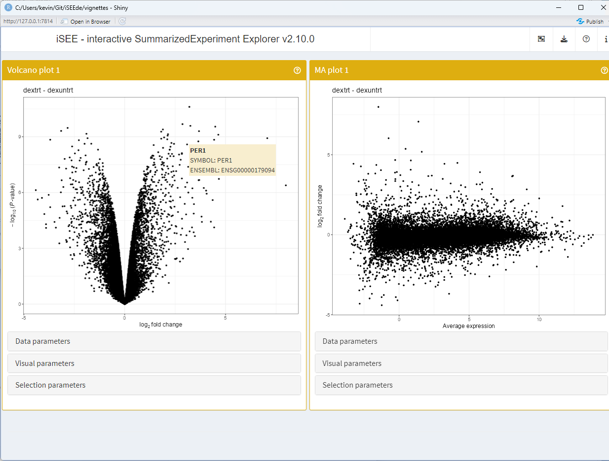

# Using annotations to facilitate interactive exploration

## Example data

In this example, we use the
[`?airway`](https://rdrr.io/pkg/airway/man/airway.html) data set.

\
[`library`](https://rdrr.io/r/base/library.html)`(``"airway"``)`\
[`data`](https://rdrr.io/r/utils/data.html)`(``"airway"``)`

## Annotating data

This section demonstrates one of many possible workflows for adding
annotations to the data set. Those annotations are meant to make it
easier for users to identify genes of interest, e.g. by displaying both
gene symbols and ENSEMBL gene identifiers as tooltips in the interactive
browser.

First, we make a copy of the Ensembl identifiers – currently stored in
the [`rownames()`](https://rdrr.io/r/base/colnames.html) – to a column
in the
[`rowData()`](https://rdrr.io/pkg/SummarizedExperiment/man/SummarizedExperiment-class.html)
component.

\
[`rowData`](https://rdrr.io/pkg/SummarizedExperiment/man/SummarizedExperiment-class.html)`(``airway``)``[[``"ENSEMBL"``]``]`` ``<-`` `[`rownames`](https://rdrr.io/r/base/colnames.html)`(``airway``)`

Then, we use the
*[org.Hs.eg.db](https://bioconductor.org/packages/3.24/org.Hs.eg.db)*
package to map the Ensembl identifiers to gene symbols. We store those
gene symbols as an additional column of the
[`rowData()`](https://rdrr.io/pkg/SummarizedExperiment/man/SummarizedExperiment-class.html)
component.

\
[`library`](https://rdrr.io/r/base/library.html)`(``"org.Hs.eg.db"``)`\
[`rowData`](https://rdrr.io/pkg/SummarizedExperiment/man/SummarizedExperiment-class.html)`(``airway``)``[[``"SYMBOL"``]``]`` ``<-`` `[`mapIds`](https://rdrr.io/pkg/AnnotationDbi/man/AnnotationDb-class.html)`(`\
`    ``org.Hs.eg.db``, `[`rownames`](https://rdrr.io/r/base/colnames.html)`(``airway``)``,`\
`    ``"SYMBOL"``, ``"ENSEMBL"`\
`)`

Next, we use the
[`uniquifyFeatureNames()`](https://rdrr.io/pkg/scuttle/man/uniquifyFeatureNames.html)
function of the
*[scuttle](https://bioconductor.org/packages/3.24/scuttle)* package to
replace the [`rownames()`](https://rdrr.io/r/base/colnames.html) by a
unique identifier that is generated as follows:

- The gene symbol if it is unique.
- A concatenate of the gene symbol and Ensembl gene identifier if the
  gene symbol is not unique.
- The Ensembl identifier if the gene symbol is not available.

\
[`library`](https://rdrr.io/r/base/library.html)`(`[`"scuttle"`](https://github.com/LTLA/scuttle)`)`\
[`rownames`](https://rdrr.io/r/base/colnames.html)`(``airway``)`` ``<-`` `[`uniquifyFeatureNames`](https://rdrr.io/pkg/scuttle/man/uniquifyFeatureNames.html)`(`\
`    ID ``=`` `[`rowData`](https://rdrr.io/pkg/SummarizedExperiment/man/SummarizedExperiment-class.html)`(``airway``)``[[``"ENSEMBL"``]``]``,`\
`    names ``=`` `[`rowData`](https://rdrr.io/pkg/SummarizedExperiment/man/SummarizedExperiment-class.html)`(``airway``)``[[``"SYMBOL"``]``]`\
`)`\
`airway`\
`#> class: RangedSummarizedExperiment `\
`#> dim: 63677 8 `\
`#> metadata(1): ''`\
`#> assays(1): counts`\
`#> rownames(63677): TSPAN6 TNMD ... APP-DT ENSG00000273493`\
`#> rowData names(12): gene_id gene_name ... ENSEMBL SYMBOL`\
`#> colnames(8): SRR1039508 SRR1039509 ... SRR1039520 SRR1039521`\
`#> colData names(9): SampleName cell ... Sample BioSample`

## Differential expression

To generate some example results, we first use
[`edgeR::filterByExpr()`](https://rdrr.io/pkg/edgeR/man/filterByExpr.html)
to remove genes whose counts are too low to support a rigorous
differential expression analysis. Then we run a standard Limma-Voom
analysis using `edgeR::voomLmFit()`,
[`limma::makeContrasts()`](https://rdrr.io/pkg/limma/man/makeContrasts.html),
and [`limma::eBayes()`](https://rdrr.io/pkg/limma/man/ebayes.html);
alternatively, we could have used
[`limma::treat()`](https://rdrr.io/pkg/limma/man/ebayes.html) instead of
[`limma::eBayes()`](https://rdrr.io/pkg/limma/man/ebayes.html).

The linear model includes the `dex` and `cell` covariates, indicating
the treatment conditions and cell types, respectively. Here, we are
interested in differences between treatments, adjusted by cell type, and
define this comparison as the `dextrt - dexuntrt` contrast.

The final differential expression results are fetched using
[`limma::topTable()`](https://rdrr.io/pkg/limma/man/toptable.html).

\
[`library`](https://rdrr.io/r/base/library.html)`(`[`"edgeR"`](https://bioinf.wehi.edu.au/edgeR/)`)`\
\
`design`` ``<-`` `[`model.matrix`](https://rdrr.io/r/stats/model.matrix.html)`(``~`` ``0`` ``+`` ``dex`` ``+`` ``cell``, data ``=`` `[`colData`](https://rdrr.io/pkg/SummarizedExperiment/man/SummarizedExperiment-class.html)`(``airway``)``)`\
\
`keep`` ``<-`` `[`filterByExpr`](https://rdrr.io/pkg/edgeR/man/filterByExpr.html)`(``airway``, ``design``)`\
`fit`` ``<-`` `[`voomLmFit`](https://rdrr.io/pkg/limma/man/voomLmFit.html)`(``airway``[``keep``, ``]``, ``design``, plot ``=`` ``FALSE``)`\
`contr`` ``<-`` `[`makeContrasts`](https://rdrr.io/pkg/limma/man/makeContrasts.html)`(``"dextrt - dexuntrt"``, levels ``=`` ``design``)`\
`fit`` ``<-`` `[`contrasts.fit`](https://rdrr.io/pkg/limma/man/contrasts.fit.html)`(``fit``, ``contr``)`\
`fit`` ``<-`` `[`eBayes`](https://rdrr.io/pkg/limma/man/ebayes.html)`(``fit``)`\
`res_limma`` ``<-`` `[`topTable`](https://rdrr.io/pkg/limma/man/toptable.html)`(``fit``, sort.by ``=`` ``"P"``, n ``=`` ``Inf``)`\
[`head`](https://rdrr.io/r/utils/head.html)`(``res_limma``)`\
`#>                 gene_id gene_name entrezid   gene_biotype gene_seq_start gene_seq_end seq_name`\
`#> CACNB2  ENSG00000165995    CACNB2       NA protein_coding       18429606     18830798       10`\
`#> DUSP1   ENSG00000120129     DUSP1       NA protein_coding      172195093    172198198        5`\
`#> PRSS35  ENSG00000146250    PRSS35       NA protein_coding       84222194     84235423        6`\
`#> MAOA    ENSG00000189221      MAOA       NA protein_coding       43515467     43606068        X`\
`#> SPARCL1 ENSG00000152583   SPARCL1       NA protein_coding       88394487     88452213        4`\
`#> STEAP2  ENSG00000157214    STEAP2       NA protein_coding       89796904     89867451        7`\
`#>         seq_strand seq_coord_system  symbol         ENSEMBL  SYMBOL     logFC  AveExpr         t`\
`#> CACNB2           1               NA  CACNB2 ENSG00000165995  CACNB2  3.205585 3.682244  37.81643`\
`#> DUSP1           -1               NA   DUSP1 ENSG00000120129   DUSP1  2.864798 6.644455  28.50912`\
`#> PRSS35           1               NA  PRSS35 ENSG00000146250  PRSS35 -2.828191 3.224885 -28.23203`\
`#> MAOA             1               NA    MAOA ENSG00000189221    MAOA  3.257594 5.950559  27.69288`\
`#> SPARCL1         -1               NA SPARCL1 ENSG00000152583 SPARCL1  4.489181 4.166904  27.40418`\
`#> STEAP2           1               NA  STEAP2 ENSG00000157214  STEAP2  1.894503 6.790009  27.34493`\
`#>              P.Value    adj.P.Val        B`\
`#> CACNB2  1.053353e-10 1.775953e-06 14.49959`\
`#> DUSP1   1.119656e-09 4.051142e-06 13.02968`\
`#> PRSS35  1.214760e-09 4.051142e-06 12.49617`\
`#> MAOA    1.426822e-09 4.051142e-06 12.78445`\
`#> SPARCL1 1.557181e-09 4.051142e-06 12.37046`\
`#> STEAP2  1.585550e-09 4.051142e-06 12.71268`

Then, we embed this set of differential expression results in the
`airway` object using the
[`embedContrastResults()`](https://isee.github.io/iSEEde/reference/utils-SummarizedExperiment.md)
method and we use the function
[`contrastResults()`](https://isee.github.io/iSEEde/reference/contrastResults.md)
to display the contrast results stored in the `airway` object.

\
[`library`](https://rdrr.io/r/base/library.html)`(`[`iSEEde`](https://github.com/iSEE/iSEEde)`)`\
`#> Loading required package: iSEE`\
`airway`` ``<-`` `[`embedContrastResults`](https://isee.github.io/iSEEde/reference/utils-SummarizedExperiment.md)`(``res_limma``, ``airway``,`\
`    name ``=`` ``"dextrt - dexuntrt"``,`\
`    class ``=`` ``"limma"`\
`)`\
[`contrastResults`](https://isee.github.io/iSEEde/reference/contrastResults.md)`(``airway``)`\
`#> DataFrame with 63677 rows and 1 column`\
`#>                  dextrt - dexuntrt`\
`#>                 <iSEELimmaResults>`\
`#> TSPAN6          <iSEELimmaResults>`\
`#> TNMD            <iSEELimmaResults>`\
`#> DPM1            <iSEELimmaResults>`\
`#> SCYL3           <iSEELimmaResults>`\
`#> FIRRM           <iSEELimmaResults>`\
`#> ...                            ...`\
`#> ENSG00000273489 <iSEELimmaResults>`\
`#> ENSG00000273490 <iSEELimmaResults>`\
`#> ENSG00000273491 <iSEELimmaResults>`\
`#> APP-DT          <iSEELimmaResults>`\
`#> ENSG00000273493 <iSEELimmaResults>`\
[`contrastResults`](https://isee.github.io/iSEEde/reference/contrastResults.md)`(``airway``, ``"dextrt - dexuntrt"``)`\
`#> iSEELimmaResults with 63677 rows and 18 columns`\
`#>                         gene_id   gene_name  entrezid   gene_biotype gene_seq_start gene_seq_end`\
`#>                     <character> <character> <integer>    <character>      <integer>    <integer>`\
`#> TSPAN6          ENSG00000000003      TSPAN6        NA protein_coding       99883667     99894988`\
`#> TNMD                         NA          NA        NA             NA             NA           NA`\
`#> DPM1            ENSG00000000419        DPM1        NA protein_coding       49551404     49575092`\
`#> SCYL3           ENSG00000000457       SCYL3        NA protein_coding      169818772    169863408`\
`#> FIRRM           ENSG00000000460    C1orf112        NA protein_coding      169631245    169823221`\
`#> ...                         ...         ...       ...            ...            ...          ...`\
`#> ENSG00000273489              NA          NA        NA             NA             NA           NA`\
`#> ENSG00000273490              NA          NA        NA             NA             NA           NA`\
`#> ENSG00000273491              NA          NA        NA             NA             NA           NA`\
`#> APP-DT                       NA          NA        NA             NA             NA           NA`\
`#> ENSG00000273493              NA          NA        NA             NA             NA           NA`\
`#>                    seq_name seq_strand seq_coord_system      symbol         ENSEMBL      SYMBOL`\
`#>                 <character>  <integer>        <integer> <character>     <character> <character>`\
`#> TSPAN6                    X         -1               NA      TSPAN6 ENSG00000000003      TSPAN6`\
`#> TNMD                     NA         NA               NA          NA              NA          NA`\
`#> DPM1                     20         -1               NA        DPM1 ENSG00000000419        DPM1`\
`#> SCYL3                     1         -1               NA       SCYL3 ENSG00000000457       SCYL3`\
`#> FIRRM                     1          1               NA    C1orf112 ENSG00000000460       FIRRM`\
`#> ...                     ...        ...              ...         ...             ...         ...`\
`#> ENSG00000273489          NA         NA               NA          NA              NA          NA`\
`#> ENSG00000273490          NA         NA               NA          NA              NA          NA`\
`#> ENSG00000273491          NA         NA               NA          NA              NA          NA`\
`#> APP-DT                   NA         NA               NA          NA              NA          NA`\
`#> ENSG00000273493          NA         NA               NA          NA              NA          NA`\
`#>                      logFC   AveExpr         t    P.Value  adj.P.Val         B`\
`#>                  <numeric> <numeric> <numeric>  <numeric>  <numeric> <numeric>`\
`#> TSPAN6          -0.4640794   5.02559 -6.627486 0.00013017 0.00164997  0.947823`\
`#> TNMD                    NA        NA        NA         NA         NA        NA`\
`#> DPM1             0.1251282   4.60191  1.643118 0.13706950 0.24962106 -6.263296`\
`#> SCYL3           -0.0420454   3.47269 -0.440210 0.67086001 0.77758145 -7.231174`\
`#> FIRRM           -0.2282190   1.40857 -0.980043 0.35436323 0.49554924 -6.208629`\
`#> ...                    ...       ...       ...        ...        ...       ...`\
`#> ENSG00000273489         NA        NA        NA         NA         NA        NA`\
`#> ENSG00000273490         NA        NA        NA         NA         NA        NA`\
`#> ENSG00000273491         NA        NA        NA         NA         NA        NA`\
`#> APP-DT                  NA        NA        NA         NA         NA        NA`\
`#> ENSG00000273493         NA        NA        NA         NA         NA        NA`

## Live app

In this example, we use
[`iSEE::panelDefaults()`](https://isee.github.io/iSEE/reference/panelDefaults.html)
to specify
[`rowData()`](https://rdrr.io/pkg/SummarizedExperiment/man/SummarizedExperiment-class.html)
fields to show in the tooltip that is displayed when hovering a data
point.

The application is then configured to display the volcano plot and MA
plot for the same contrast.

Finally, the configured app is launched.

\
[`library`](https://rdrr.io/r/base/library.html)`(`[`iSEE`](https://isee.github.io/iSEE/)`)`\
\
[`panelDefaults`](https://isee.github.io/iSEE/reference/panelDefaults.html)`(`\
`    TooltipRowData ``=`` `[`c`](https://rdrr.io/r/base/c.html)`(``"SYMBOL"``, ``"ENSEMBL"``)`\
`)`\
\
`app`` ``<-`` `[`iSEE`](https://isee.github.io/iSEE/reference/iSEE.html)`(``airway``, initial ``=`` `[`list`](https://rdrr.io/r/base/list.html)`(`\
`    `[`VolcanoPlot`](https://isee.github.io/iSEEde/reference/VolcanoPlot-class.md)`(``ContrastName ``=`` ``"dextrt - dexuntrt"``, PanelWidth ``=`` ``6L``)``,`\
`    `[`MAPlot`](https://isee.github.io/iSEEde/reference/MAPlot-class.md)`(``ContrastName ``=`` ``"dextrt - dexuntrt"``, PanelWidth ``=`` ``6L``)`\
`)``)`\
\
`if`` ``(`[`interactive`](https://rdrr.io/r/base/interactive.html)`(``)``)`` ``{`\
`    ``shiny``::`[`runApp`](https://rdrr.io/pkg/shiny/man/runApp.html)`(``app``)`\
`}`

## Reproducibility

The *[iSEEde](https://bioconductor.org/packages/3.24/iSEEde)* package
(Rue-Albrecht, 2024) was made possible thanks to:

- R (R Core Team, 2026)
- *[BiocStyle](https://bioconductor.org/packages/3.24/BiocStyle)* (Oleś,
  2026)
- *[knitr](https://CRAN.R-project.org/package=knitr)* (Xie, 2026)
- *[RefManageR](https://CRAN.R-project.org/package=RefManageR)* (McLean,
  2017)
- *[rmarkdown](https://CRAN.R-project.org/package=rmarkdown)* (Allaire,
  Xie, Dervieux, McPherson, Luraschi, Ushey, Atkins, Wickham, Cheng,
  Chang, and Iannone, 2026)
- *[sessioninfo](https://CRAN.R-project.org/package=sessioninfo)*
  (Wickham, Chang, Flight, Müller, and Hester, 2026)
- *[testthat](https://CRAN.R-project.org/package=testthat)* (Wickham,
  2011)

This package was developed using
*[biocthis](https://bioconductor.org/packages/3.24/biocthis)*.

Code for creating the vignette

\
`## Create the vignette`\
[`library`](https://rdrr.io/r/base/library.html)`(`[`"rmarkdown"`](https://github.com/rstudio/rmarkdown)`)`\
[`system.time`](https://rdrr.io/r/base/system.time.html)`(`[`render`](https://pkgs.rstudio.com/rmarkdown/reference/render.html)`(``"annotations.Rmd"``, ``"BiocStyle::html_document"``)``)`\
\
`## Extract the R code`\
[`library`](https://rdrr.io/r/base/library.html)`(`[`"knitr"`](https://yihui.org/knitr/)`)`\
[`knit`](https://rdrr.io/pkg/knitr/man/knit.html)`(``"annotations.Rmd"``, tangle ``=`` ``TRUE``)`

Date the vignette was generated.

    #> [1] "2026-10-22 13:56:26 UTC"

Wallclock time spent generating the vignette.

    #> Time difference of 11.316 secs

`R` session information.

    #> ─ Session info ───────────────────────────────────────────────────────────────────────────────────────────────────────
    #>  setting  value
    #>  version  R version 4.6.1 (2026-06-24)
    #>  os       Ubuntu 24.04.5 LTS
    #>  system   x86_64, linux-gnu
    #>  ui       X11
    #>  language en
    #>  collate  en_US.UTF-8
    #>  ctype    en_US.UTF-8
    #>  tz       UTC
    #>  date     2026-10-22
    #>  pandoc   3.12.1 @ /usr/bin/ (via rmarkdown)
    #>  quarto   1.10.18 @ /usr/local/bin/quarto
    #> 
    #> ─ Packages ───────────────────────────────────────────────────────────────────────────────────────────────────────────
    #>  package              * version  date (UTC) lib source
    #>  abind                  1.4-8    2024-09-12 [1] RSPM (R 4.6.0)
    #>  airway               * 1.33.2   2026-07-21 [1] Bioconductor 3.24 (R 4.6.1)
    #>  AnnotationDbi        * 1.75.2   2026-07-21 [1] Bioconductor 3.24 (R 4.6.1)
    #>  beachmat               2.29.3   2026-09-23 [1] Bioconductor 3.24 (R 4.6.1)
    #>  bibtex                 0.5.3    2026-09-22 [1] RSPM (R 4.6.0)
    #>  Biobase              * 2.73.2   2026-07-29 [1] Bioconductor 3.24 (R 4.6.1)
    #>  BiocBaseUtils          1.15.1   2026-05-10 [1] Bioconductor 3.24 (R 4.6.1)
    #>  BiocGenerics         * 0.59.12  2026-08-11 [1] Bioconductor 3.24 (R 4.6.1)
    #>  BiocManager            1.30.27  2025-11-14 [2] CRAN (R 4.6.1)
    #>  BiocParallel           1.47.0   2026-04-28 [1] Bioconductor 3.24 (R 4.6.1)
    #>  BiocStyle            * 2.41.0   2026-04-28 [1] Bioconductor 3.24 (R 4.6.1)
    #>  Biostrings             2.81.9   2026-09-06 [1] Bioconductor 3.24 (R 4.6.1)
    #>  bit                    4.6.0    2025-03-06 [1] RSPM (R 4.6.0)
    #>  bit64                  4.8.6    2026-09-01 [1] RSPM (R 4.6.0)
    #>  blob                   1.3.0    2026-01-14 [1] RSPM (R 4.6.0)
    #>  bookdown               0.48     2026-08-28 [1] RSPM (R 4.6.0)
    #>  bslib                  0.12.0   2026-08-04 [2] RSPM (R 4.6.0)
    #>  cachem                 1.1.0    2024-05-16 [2] RSPM (R 4.6.0)
    #>  circlize               0.4.18   2026-04-04 [1] RSPM (R 4.6.0)
    #>  cli                    3.6.6    2026-04-09 [2] RSPM (R 4.6.0)
    #>  clue                   0.3-68   2026-03-26 [1] RSPM (R 4.6.0)
    #>  cluster                2.1.8.3  2026-07-30 [2] RSPM (R 4.6.0)
    #>  codetools              0.2-20   2024-03-31 [3] CRAN (R 4.6.1)
    #>  colorspace             2.1-4    2026-10-08 [1] RSPM (R 4.6.0)
    #>  colourpicker           1.3.0    2023-08-21 [1] RSPM (R 4.6.0)
    #>  ComplexHeatmap         2.29.0   2026-04-28 [1] Bioconductor 3.24 (R 4.6.1)
    #>  crayon                 1.5.3    2024-06-20 [2] RSPM (R 4.6.0)
    #>  DBI                    1.3.0    2026-02-25 [1] RSPM (R 4.6.0)
    #>  DelayedArray           0.39.8   2026-09-30 [1] Bioconductor 3.24 (R 4.6.1)
    #>  desc                   1.4.3    2023-12-10 [2] RSPM (R 4.6.0)
    #>  DESeq2                 1.53.6   2026-10-02 [1] Bioconductor 3.24 (R 4.6.1)
    #>  digest                 0.6.39   2025-11-19 [2] RSPM (R 4.6.0)
    #>  doParallel             1.0.17   2022-02-07 [1] RSPM (R 4.6.0)
    #>  dplyr                  1.2.1    2026-04-03 [1] RSPM (R 4.6.0)
    #>  DT                     0.34.0   2025-09-02 [1] RSPM (R 4.6.0)
    #>  edgeR                * 4.99.10  2026-10-18 [1] Bioconductor 3.24 (R 4.6.1)
    #>  evaluate               1.0.5    2025-08-27 [2] RSPM (R 4.6.0)
    #>  farver                 2.1.2    2024-05-13 [1] RSPM (R 4.6.0)
    #>  fastmap                1.2.0    2024-05-15 [2] RSPM (R 4.6.0)
    #>  fontawesome            0.5.3    2024-11-16 [2] RSPM (R 4.6.0)
    #>  foreach                1.5.2    2022-02-02 [1] RSPM (R 4.6.0)
    #>  fs                     2.1.0    2026-04-18 [2] RSPM (R 4.6.0)
    #>  generics             * 0.1.4    2025-05-09 [1] RSPM (R 4.6.0)
    #>  GenomicRanges        * 1.65.4   2026-09-02 [1] Bioconductor 3.24 (R 4.6.1)
    #>  GetoptLong             1.1.1    2026-04-08 [1] RSPM (R 4.6.0)
    #>  ggplot2                4.0.3    2026-04-22 [1] RSPM (R 4.6.0)
    #>  ggrepel                0.9.8    2026-03-17 [1] RSPM (R 4.6.0)
    #>  GlobalOptions          0.1.4    2026-04-08 [1] RSPM (R 4.6.0)
    #>  glue                   1.8.1    2026-04-17 [2] RSPM (R 4.6.0)
    #>  gtable                 0.3.6    2024-10-25 [1] RSPM (R 4.6.0)
    #>  htmltools              0.5.9    2025-12-04 [2] RSPM (R 4.6.0)
    #>  htmlwidgets            1.6.4    2023-12-06 [2] RSPM (R 4.6.0)
    #>  httpuv                 1.6.17   2026-03-18 [2] RSPM (R 4.6.0)
    #>  httr                   1.4.9    2026-09-01 [1] RSPM (R 4.6.0)
    #>  igraph                 2.3.4    2026-09-30 [1] RSPM (R 4.6.0)
    #>  IRanges              * 2.47.5   2026-08-27 [1] Bioconductor 3.24 (R 4.6.1)
    #>  iSEE                 * 2.25.1   2026-07-13 [1] Bioconductor 3.24 (R 4.6.1)
    #>  iSEEde               * 1.11.0   2026-10-22 [1] Bioconductor
    #>  iterators              1.0.14   2022-02-05 [1] RSPM (R 4.6.0)
    #>  jquerylib              0.1.4    2021-04-26 [2] RSPM (R 4.6.0)
    #>  jsonlite               2.0.0    2025-03-27 [2] RSPM (R 4.6.0)
    #>  KEGGREST               1.53.6   2026-07-23 [1] Bioconductor 3.24 (R 4.6.1)
    #>  knitr                  1.52     2026-09-06 [2] RSPM (R 4.6.0)
    #>  later                  1.4.8    2026-03-05 [2] RSPM (R 4.6.0)
    #>  lattice                0.23-1   2026-08-12 [2] RSPM (R 4.6.0)
    #>  lifecycle              1.0.5    2026-01-08 [2] RSPM (R 4.6.0)
    #>  limma                * 3.99.2   2026-10-13 [1] Bioconductor 3.24 (R 4.6.1)
    #>  listviewer             4.0.0    2023-09-30 [1] RSPM (R 4.6.0)
    #>  locfit                 1.5-9.12 2025-03-05 [1] RSPM (R 4.6.0)
    #>  lubridate              1.9.5    2026-02-04 [1] RSPM (R 4.6.0)
    #>  magrittr               2.0.5    2026-04-04 [2] RSPM (R 4.6.0)
    #>  Matrix                 1.7-6    2026-07-25 [2] RSPM (R 4.6.0)
    #>  MatrixGenerics       * 1.25.0   2026-04-28 [1] Bioconductor 3.24 (R 4.6.1)
    #>  matrixStats          * 1.5.0    2025-01-07 [1] RSPM (R 4.6.0)
    #>  memoise                2.0.1    2021-11-26 [2] RSPM (R 4.6.0)
    #>  mgcv                   1.9-4    2025-11-07 [3] CRAN (R 4.6.1)
    #>  mime                   0.13     2025-03-17 [2] RSPM (R 4.6.0)
    #>  miniUI                 0.1.2    2025-04-17 [2] RSPM (R 4.6.0)
    #>  nlme                   3.1-171  2026-09-01 [2] RSPM (R 4.6.0)
    #>  org.Hs.eg.db         * 3.23.1   2026-07-20 [1] Bioconductor
    #>  otel                   0.2.0    2025-08-29 [2] RSPM (R 4.6.0)
    #>  pillar                 1.11.1   2025-09-17 [2] RSPM (R 4.6.0)
    #>  pkgconfig              2.0.3    2019-09-22 [2] RSPM (R 4.6.0)
    #>  pkgdown                2.2.1    2026-07-07 [2] RSPM (R 4.6.0)
    #>  plyr                   1.8.9    2023-10-02 [1] RSPM (R 4.6.0)
    #>  png                    0.1-9    2026-03-15 [1] RSPM (R 4.6.0)
    #>  promises               1.5.0    2025-11-01 [2] RSPM (R 4.6.0)
    #>  R6                     2.6.1    2025-02-15 [2] RSPM (R 4.6.0)
    #>  ragg                   1.5.2    2026-03-23 [2] RSPM (R 4.6.0)
    #>  RColorBrewer           1.1-3    2022-04-03 [1] RSPM (R 4.6.0)
    #>  Rcpp                   1.1.2    2026-07-05 [2] RSPM (R 4.6.0)
    #>  RefManageR           * 1.4.0    2022-09-30 [1] RSPM (R 4.6.0)
    #>  rintrojs               0.3.4    2024-01-11 [1] RSPM (R 4.6.0)
    #>  rjson                  0.2.23   2024-09-16 [1] RSPM (R 4.6.0)
    #>  rlang                  1.3.0    2026-07-05 [2] RSPM (R 4.6.0)
    #>  rmarkdown              2.32     2026-09-01 [2] RSPM (R 4.6.0)
    #>  RSQLite                3.53.3   2026-06-30 [1] RSPM (R 4.6.0)
    #>  S4Arrays               1.13.2   2026-09-30 [1] Bioconductor 3.24 (R 4.6.1)
    #>  S4Vectors            * 0.51.10  2026-09-16 [1] Bioconductor 3.24 (R 4.6.1)
    #>  S7                     0.2.2    2026-04-22 [1] RSPM (R 4.6.0)
    #>  sass                   0.4.10   2025-04-11 [2] RSPM (R 4.6.0)
    #>  scales                 1.4.0    2025-04-24 [1] RSPM (R 4.6.0)
    #>  scuttle              * 1.23.2   2026-08-27 [1] Bioconductor 3.24 (R 4.6.1)
    #>  Seqinfo              * 1.3.2    2026-08-27 [1] Bioconductor 3.24 (R 4.6.1)
    #>  sessioninfo          * 1.2.4    2026-06-04 [2] RSPM (R 4.6.0)
    #>  shape                  1.4.6.1  2024-02-23 [1] RSPM (R 4.6.0)
    #>  shiny                  1.14.0   2026-06-21 [2] RSPM (R 4.6.0)
    #>  shinyAce               0.4.4    2025-02-03 [1] RSPM (R 4.6.0)
    #>  shinydashboard         0.7.3    2025-04-21 [1] RSPM (R 4.6.0)
    #>  shinyjs                2.1.1    2026-01-15 [1] RSPM (R 4.6.0)
    #>  shinyWidgets           0.9.1    2026-03-09 [1] RSPM (R 4.6.0)
    #>  SingleCellExperiment * 1.35.2   2026-07-16 [1] Bioconductor 3.24 (R 4.6.1)
    #>  SparseArray            1.13.4   2026-09-30 [1] Bioconductor 3.24 (R 4.6.1)
    #>  statmod                1.5.2    2026-05-17 [1] RSPM (R 4.6.0)
    #>  stringi                1.8.9    2026-08-04 [2] RSPM (R 4.6.0)
    #>  stringr                1.6.0    2025-11-04 [1] RSPM (R 4.6.0)
    #>  SummarizedExperiment * 1.43.0   2026-04-28 [1] Bioconductor 3.24 (R 4.6.1)
    #>  systemfonts            1.3.2    2026-03-05 [2] RSPM (R 4.6.0)
    #>  textshaping            1.0.5    2026-03-06 [2] RSPM (R 4.6.0)
    #>  tibble                 3.3.1    2026-01-11 [2] RSPM (R 4.6.0)
    #>  tidyselect             1.2.1    2024-03-11 [1] RSPM (R 4.6.0)
    #>  timechange             0.4.0    2026-01-29 [1] RSPM (R 4.6.0)
    #>  vctrs                  0.7.3    2026-04-11 [2] RSPM (R 4.6.0)
    #>  vipor                  0.4.7    2023-12-18 [1] RSPM (R 4.6.0)
    #>  viridisLite            0.4.3    2026-02-04 [1] RSPM (R 4.6.0)
    #>  xfun                   0.62     2026-10-16 [2] RSPM (R 4.6.0)
    #>  xml2                   1.6.0    2026-06-22 [2] RSPM (R 4.6.0)
    #>  xtable                 1.8-8    2026-02-22 [2] RSPM (R 4.6.0)
    #>  XVector                0.53.0   2026-04-28 [1] Bioconductor 3.24 (R 4.6.1)
    #>  yaml                   2.3.12   2025-12-10 [2] RSPM (R 4.6.0)
    #> 
    #>  [1] /__w/_temp/Library
    #>  [2] /usr/local/lib/R/site-library
    #>  [3] /usr/local/lib/R/library
    #>  * ── Packages attached to the search path.
    #> 
    #> ──────────────────────────────────────────────────────────────────────────────────────────────────────────────────────

## Bibliography

This vignette was generated using
*[BiocStyle](https://bioconductor.org/packages/3.24/BiocStyle)* (Oleś,
2026) with *[knitr](https://CRAN.R-project.org/package=knitr)* (Xie,
2026) and *[rmarkdown](https://CRAN.R-project.org/package=rmarkdown)*
(Allaire, Xie, Dervieux et al., 2026) running behind the scenes.

Citations made with
*[RefManageR](https://CRAN.R-project.org/package=RefManageR)* (McLean,
2017).

[\[1\]](#cite-allaire2026rmarkdown) J. Allaire, Y. Xie, C. Dervieux, et
al. *rmarkdown: Dynamic Documents for R*. R package version 2.32. 2026.
URL: <https://github.com/rstudio/rmarkdown>.

[\[2\]](#cite-mclean2017refmanager) M. W. McLean. “RefManageR: Import
and Manage BibTeX and BibLaTeX References in R”. In: *The Journal of
Open Source Software* (2017). DOI:
[10.21105/joss.00338](https://doi.org/10.21105/joss.00338).

[\[3\]](#cite-ole2026biocstyle) A. Oleś. *BiocStyle: Standard styles for
vignettes and other Bioconductor documents*. R package version 2.41.0.
2026. DOI:
[10.18129/B9.bioc.BiocStyle](https://doi.org/10.18129/B9.bioc.BiocStyle).
URL: <https://bioconductor.org/packages/BiocStyle>.

[\[4\]](#cite-2026language) R Core Team. *R: A Language and Environment
for Statistical Computing*. R Foundation for Statistical Computing (ROR:
\<<https://ror.org/05qewa988%3E>;). Vienna, Austria, 2026. DOI:
[10.32614/R.manuals](https://doi.org/10.32614/R.manuals). URL:
<https://www.R-project.org/>.

[\[5\]](#cite-ruealbrecht2024iseede) K. Rue-Albrecht. *iSEEde: iSEE
extension for panels related to differential expression analysis*. R
package version 1.11.0. 2024. URL: <https://github.com/iSEE/iSEEde>.

[\[6\]](#cite-wickham2011testthat) H. Wickham. “testthat: Get Started
with Testing”. In: *The R Journal* 3 (2011), pp. 5–10. URL:
<https://journal.r-project.org/articles/RJ-2011-002/>.

[\[7\]](#cite-wickham2026sessioninfo) H. Wickham, W. Chang, R. Flight,
et al. *sessioninfo: R Session Information*. R package version 1.2.4.
2026. URL: <https://sessioninfo.r-lib.org>.

[\[8\]](#cite-xie2026knitr) Y. Xie. *knitr: A General-Purpose Package
for Dynamic Report Generation in R*. R package version 1.52. 2026. URL:
<https://yihui.org/knitr/>.
