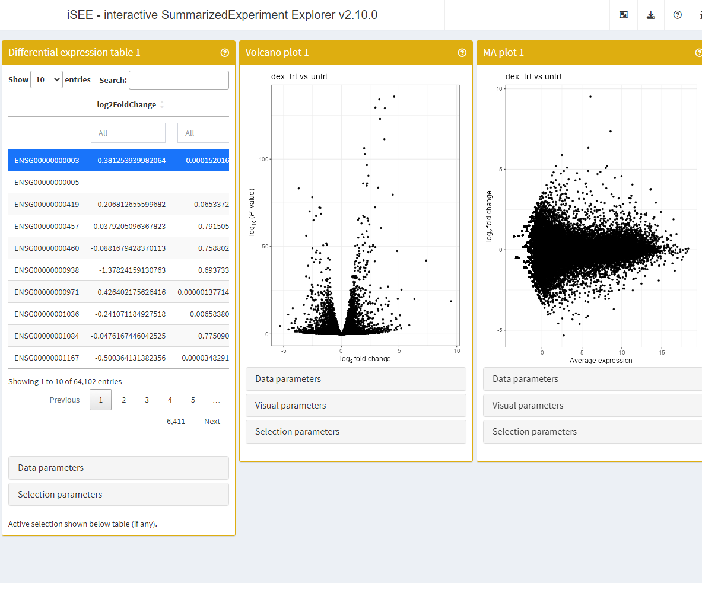

# Introduction to iSEEde

## Basics

### Install `iSEEde`

![](data:image/svg+xml;base64,PHN2ZyBhcmlhLWhpZGRlbj0idHJ1ZSIgcm9sZT0iaW1nIiB2aWV3Ym94PSIwIDAgNTgxIDUxMiIgc3R5bGU9ImhlaWdodDoxZW07d2lkdGg6MS4xM2VtO3ZlcnRpY2FsLWFsaWduOi0wLjEyNWVtO21hcmdpbi1sZWZ0OmF1dG87bWFyZ2luLXJpZ2h0OmF1dG87Zm9udC1zaXplOmluaGVyaXQ7ZmlsbDpjdXJyZW50Q29sb3I7b3ZlcmZsb3c6dmlzaWJsZTtwb3NpdGlvbjpyZWxhdGl2ZTsiPjxwYXRoIGQ9Ik01ODEgMjI2LjZDNTgxIDExOS4xIDQ1MC45IDMyIDI5MC41IDMyUzAgMTE5LjEgMCAyMjYuNkMwIDMyMi40IDEwMy4zIDQwMiAyMzkuNCA0MTguMVY0ODBoOTkuMXYtNjEuNWMyNC4zLTIuNyA0Ny42LTcuNCA2OS40LTEzLjlMNDQ4IDQ4MGgxMTJsLTY3LjQtMTEzLjdjNTQuNS0zNS40IDg4LjQtODQuOSA4OC40LTEzOS43em0tNDY2LjggMTQuNWMwLTczLjUgOTguOS0xMzMgMjIwLjgtMTMzczIxMS45IDQwLjcgMjExLjkgMTMzYzAgNTAuMS0yNi41IDg1LTcwLjMgMTA2LjQtMi40LTEuNi00LjctMi45LTYuNC0zLjctMTAuMi01LjItMjcuOC0xMC41LTI3LjgtMTAuNXM4Ni42LTYuNCA4Ni42LTkyLjctOTAuNi04Ny45LTkwLjYtODcuOWgtMTk5VjM2MWMtNzQuMS0yMS41LTEyNS4yLTY3LjEtMTI1LjItMTE5Ljl6bTIyNS4xIDM4LjN2LTU1LjZjNTcuOCAwIDg3LjgtNi44IDg3LjggMjcuMyAwIDM2LjUtMzguMiAyOC4zLTg3LjggMjguM3ptLS45IDcyLjVIMzY1YzEwLjggMCAxOC45IDExLjcgMjQgMTkuMi0xNi4xIDEuOS0zMyAyLjgtNTAuNiAyLjl2LTIyLjF6IiAvPjwvc3ZnPg==)
is an open-source statistical environment which can be easily modified
to enhance its functionality via packages.
*[iSEEde](https://bioconductor.org/packages/3.24/iSEEde)* is an
![](data:image/svg+xml;base64,PHN2ZyBhcmlhLWhpZGRlbj0idHJ1ZSIgcm9sZT0iaW1nIiB2aWV3Ym94PSIwIDAgNTgxIDUxMiIgc3R5bGU9ImhlaWdodDoxZW07d2lkdGg6MS4xM2VtO3ZlcnRpY2FsLWFsaWduOi0wLjEyNWVtO21hcmdpbi1sZWZ0OmF1dG87bWFyZ2luLXJpZ2h0OmF1dG87Zm9udC1zaXplOmluaGVyaXQ7ZmlsbDpjdXJyZW50Q29sb3I7b3ZlcmZsb3c6dmlzaWJsZTtwb3NpdGlvbjpyZWxhdGl2ZTsiPjxwYXRoIGQ9Ik01ODEgMjI2LjZDNTgxIDExOS4xIDQ1MC45IDMyIDI5MC41IDMyUzAgMTE5LjEgMCAyMjYuNkMwIDMyMi40IDEwMy4zIDQwMiAyMzkuNCA0MTguMVY0ODBoOTkuMXYtNjEuNWMyNC4zLTIuNyA0Ny42LTcuNCA2OS40LTEzLjlMNDQ4IDQ4MGgxMTJsLTY3LjQtMTEzLjdjNTQuNS0zNS40IDg4LjQtODQuOSA4OC40LTEzOS43em0tNDY2LjggMTQuNWMwLTczLjUgOTguOS0xMzMgMjIwLjgtMTMzczIxMS45IDQwLjcgMjExLjkgMTMzYzAgNTAuMS0yNi41IDg1LTcwLjMgMTA2LjQtMi40LTEuNi00LjctMi45LTYuNC0zLjctMTAuMi01LjItMjcuOC0xMC41LTI3LjgtMTAuNXM4Ni42LTYuNCA4Ni42LTkyLjctOTAuNi04Ny45LTkwLjYtODcuOWgtMTk5VjM2MWMtNzQuMS0yMS41LTEyNS4yLTY3LjEtMTI1LjItMTE5Ljl6bTIyNS4xIDM4LjN2LTU1LjZjNTcuOCAwIDg3LjgtNi44IDg3LjggMjcuMyAwIDM2LjUtMzguMiAyOC4zLTg3LjggMjguM3ptLS45IDcyLjVIMzY1YzEwLjggMCAxOC45IDExLjcgMjQgMTkuMi0xNi4xIDEuOS0zMyAyLjgtNTAuNiAyLjl2LTIyLjF6IiAvPjwvc3ZnPg==)
package available via the [Bioconductor](http://bioconductor.org)
repository for packages.
![](data:image/svg+xml;base64,PHN2ZyBhcmlhLWhpZGRlbj0idHJ1ZSIgcm9sZT0iaW1nIiB2aWV3Ym94PSIwIDAgNTgxIDUxMiIgc3R5bGU9ImhlaWdodDoxZW07d2lkdGg6MS4xM2VtO3ZlcnRpY2FsLWFsaWduOi0wLjEyNWVtO21hcmdpbi1sZWZ0OmF1dG87bWFyZ2luLXJpZ2h0OmF1dG87Zm9udC1zaXplOmluaGVyaXQ7ZmlsbDpjdXJyZW50Q29sb3I7b3ZlcmZsb3c6dmlzaWJsZTtwb3NpdGlvbjpyZWxhdGl2ZTsiPjxwYXRoIGQ9Ik01ODEgMjI2LjZDNTgxIDExOS4xIDQ1MC45IDMyIDI5MC41IDMyUzAgMTE5LjEgMCAyMjYuNkMwIDMyMi40IDEwMy4zIDQwMiAyMzkuNCA0MTguMVY0ODBoOTkuMXYtNjEuNWMyNC4zLTIuNyA0Ny42LTcuNCA2OS40LTEzLjlMNDQ4IDQ4MGgxMTJsLTY3LjQtMTEzLjdjNTQuNS0zNS40IDg4LjQtODQuOSA4OC40LTEzOS43em0tNDY2LjggMTQuNWMwLTczLjUgOTguOS0xMzMgMjIwLjgtMTMzczIxMS45IDQwLjcgMjExLjkgMTMzYzAgNTAuMS0yNi41IDg1LTcwLjMgMTA2LjQtMi40LTEuNi00LjctMi45LTYuNC0zLjctMTAuMi01LjItMjcuOC0xMC41LTI3LjgtMTAuNXM4Ni42LTYuNCA4Ni42LTkyLjctOTAuNi04Ny45LTkwLjYtODcuOWgtMTk5VjM2MWMtNzQuMS0yMS41LTEyNS4yLTY3LjEtMTI1LjItMTE5Ljl6bTIyNS4xIDM4LjN2LTU1LjZjNTcuOCAwIDg3LjgtNi44IDg3LjggMjcuMyAwIDM2LjUtMzguMiAyOC4zLTg3LjggMjguM3ptLS45IDcyLjVIMzY1YzEwLjggMCAxOC45IDExLjcgMjQgMTkuMi0xNi4xIDEuOS0zMyAyLjgtNTAuNiAyLjl2LTIyLjF6IiAvPjwvc3ZnPg==)
can be installed on any operating system from
[CRAN](https://cran.r-project.org/) after which you can install
*[iSEEde](https://bioconductor.org/packages/3.24/iSEEde)* by using the
following commands in your
![](data:image/svg+xml;base64,PHN2ZyBhcmlhLWhpZGRlbj0idHJ1ZSIgcm9sZT0iaW1nIiB2aWV3Ym94PSIwIDAgNTgxIDUxMiIgc3R5bGU9ImhlaWdodDoxZW07d2lkdGg6MS4xM2VtO3ZlcnRpY2FsLWFsaWduOi0wLjEyNWVtO21hcmdpbi1sZWZ0OmF1dG87bWFyZ2luLXJpZ2h0OmF1dG87Zm9udC1zaXplOmluaGVyaXQ7ZmlsbDpjdXJyZW50Q29sb3I7b3ZlcmZsb3c6dmlzaWJsZTtwb3NpdGlvbjpyZWxhdGl2ZTsiPjxwYXRoIGQ9Ik01ODEgMjI2LjZDNTgxIDExOS4xIDQ1MC45IDMyIDI5MC41IDMyUzAgMTE5LjEgMCAyMjYuNkMwIDMyMi40IDEwMy4zIDQwMiAyMzkuNCA0MTguMVY0ODBoOTkuMXYtNjEuNWMyNC4zLTIuNyA0Ny42LTcuNCA2OS40LTEzLjlMNDQ4IDQ4MGgxMTJsLTY3LjQtMTEzLjdjNTQuNS0zNS40IDg4LjQtODQuOSA4OC40LTEzOS43em0tNDY2LjggMTQuNWMwLTczLjUgOTguOS0xMzMgMjIwLjgtMTMzczIxMS45IDQwLjcgMjExLjkgMTMzYzAgNTAuMS0yNi41IDg1LTcwLjMgMTA2LjQtMi40LTEuNi00LjctMi45LTYuNC0zLjctMTAuMi01LjItMjcuOC0xMC41LTI3LjgtMTAuNXM4Ni42LTYuNCA4Ni42LTkyLjctOTAuNi04Ny45LTkwLjYtODcuOWgtMTk5VjM2MWMtNzQuMS0yMS41LTEyNS4yLTY3LjEtMTI1LjItMTE5Ljl6bTIyNS4xIDM4LjN2LTU1LjZjNTcuOCAwIDg3LjgtNi44IDg3LjggMjcuMyAwIDM2LjUtMzguMiAyOC4zLTg3LjggMjguM3ptLS45IDcyLjVIMzY1YzEwLjggMCAxOC45IDExLjcgMjQgMTkuMi0xNi4xIDEuOS0zMyAyLjgtNTAuNiAyLjl2LTIyLjF6IiAvPjwvc3ZnPg==)
session:

\
`if`` ``(``!`[`requireNamespace`](https://rdrr.io/r/base/ns-load.html)`(``"BiocManager"``, quietly ``=`` ``TRUE``)``)`` ``{`\
`    `[`install.packages`](https://rdrr.io/r/utils/install.packages.html)`(``"BiocManager"``)`\
`}`\
\
`BiocManager``::`[`install`](https://bioconductor.github.io/BiocManager/reference/install.html)`(``"iSEEde"``)`\
\
`## Check that you have a valid Bioconductor installation`\
`BiocManager``::`[`valid`](https://bioconductor.github.io/BiocManager/reference/valid.html)`(``)`

### Required knowledge

*[iSEEde](https://bioconductor.org/packages/3.24/iSEEde)* is based on
many other packages and in particular on those that have implemented the
infrastructure needed for dealing with omics data and interactive
visualisation. That is, packages like
*[SummarizedExperiment](https://bioconductor.org/packages/3.24/SummarizedExperiment)*,
*[SingleCellExperiment](https://bioconductor.org/packages/3.24/SingleCellExperiment)*,
*[iSEE](https://bioconductor.org/packages/3.24/iSEE)* and
*[shiny](https://bioconductor.org/packages/3.24/shiny)*.

If you are asking yourself the question “Where do I start using
Bioconductor?” you might be interested in [this blog
post](http://lcolladotor.github.io/2014/10/16/startbioc/#.VkOKbq6rRuU).

### Asking for help

As package developers, we try to explain clearly how to use our packages
and in which order to use the functions. But
![](data:image/svg+xml;base64,PHN2ZyBhcmlhLWhpZGRlbj0idHJ1ZSIgcm9sZT0iaW1nIiB2aWV3Ym94PSIwIDAgNTgxIDUxMiIgc3R5bGU9ImhlaWdodDoxZW07d2lkdGg6MS4xM2VtO3ZlcnRpY2FsLWFsaWduOi0wLjEyNWVtO21hcmdpbi1sZWZ0OmF1dG87bWFyZ2luLXJpZ2h0OmF1dG87Zm9udC1zaXplOmluaGVyaXQ7ZmlsbDpjdXJyZW50Q29sb3I7b3ZlcmZsb3c6dmlzaWJsZTtwb3NpdGlvbjpyZWxhdGl2ZTsiPjxwYXRoIGQ9Ik01ODEgMjI2LjZDNTgxIDExOS4xIDQ1MC45IDMyIDI5MC41IDMyUzAgMTE5LjEgMCAyMjYuNkMwIDMyMi40IDEwMy4zIDQwMiAyMzkuNCA0MTguMVY0ODBoOTkuMXYtNjEuNWMyNC4zLTIuNyA0Ny42LTcuNCA2OS40LTEzLjlMNDQ4IDQ4MGgxMTJsLTY3LjQtMTEzLjdjNTQuNS0zNS40IDg4LjQtODQuOSA4OC40LTEzOS43em0tNDY2LjggMTQuNWMwLTczLjUgOTguOS0xMzMgMjIwLjgtMTMzczIxMS45IDQwLjcgMjExLjkgMTMzYzAgNTAuMS0yNi41IDg1LTcwLjMgMTA2LjQtMi40LTEuNi00LjctMi45LTYuNC0zLjctMTAuMi01LjItMjcuOC0xMC41LTI3LjgtMTAuNXM4Ni42LTYuNCA4Ni42LTkyLjctOTAuNi04Ny45LTkwLjYtODcuOWgtMTk5VjM2MWMtNzQuMS0yMS41LTEyNS4yLTY3LjEtMTI1LjItMTE5Ljl6bTIyNS4xIDM4LjN2LTU1LjZjNTcuOCAwIDg3LjgtNi44IDg3LjggMjcuMyAwIDM2LjUtMzguMiAyOC4zLTg3LjggMjguM3ptLS45IDcyLjVIMzY1YzEwLjggMCAxOC45IDExLjcgMjQgMTkuMi0xNi4xIDEuOS0zMyAyLjgtNTAuNiAyLjl2LTIyLjF6IiAvPjwvc3ZnPg==)
and `Bioconductor` have a steep learning curve so it is critical to
learn where to ask for help. The blog post quoted above mentions some
but we would like to highlight the [Bioconductor support
site](https://support.bioconductor.org/) as the main resource for
getting help: remember to use the `iSEEde` tag and check [the older
posts](https://support.bioconductor.org/t/iSEEde/). Other alternatives
are available such as creating GitHub issues and tweeting. However,
please note that if you want to receive help you should adhere to the
[posting
guidelines](http://www.bioconductor.org/help/support/posting-guide/). It
is particularly critical that you provide a small reproducible example
and your session information so package developers can track down the
source of the error.

### Citing `iSEEde`

We hope that *[iSEEde](https://bioconductor.org/packages/3.24/iSEEde)*
will be useful for your research. Please use the following information
to cite the package and the overall approach. Thank you!

\
`## Citation info`\
[`citation`](https://rdrr.io/r/utils/citation.html)`(``"iSEEde"``)`\
`#> To cite package 'iSEEde' in publications use:`\
`#> `\
`#>   Rue-Albrecht K (2024). _iSEEde: iSEE extension for panels related to differential`\
`#>   expression analysis_. R package version 1.11.0, <https://github.com/iSEE/iSEEde>.`\
`#> `\
`#> A BibTeX entry for LaTeX users is`\
`#> `\
`#>   @Manual{,`\
`#>     title = {iSEEde: iSEE extension for panels related to differential expression analysis},`\
`#>     author = {Kevin Rue-Albrecht},`\
`#>     year = {2024},`\
`#>     note = {R package version 1.11.0},`\
`#>     url = {https://github.com/iSEE/iSEEde},`\
`#>   }`

## Quick start to using to `iSEEde`

The example below demonstrates how to use
*[iSEEde](https://bioconductor.org/packages/3.24/iSEEde)* functionality
in a simple differential expression workflow.

Specifically, the
*[DESeq2](https://bioconductor.org/packages/3.24/DESeq2)* package is
used to perform a simple differential expression analysis. Then, the
results of one contrast – extracted using the function
[`DESeq2::results()`](https://rdrr.io/pkg/DESeq2/man/results.html)
function – are embedded into the
*[SummarizedExperiment](https://bioconductor.org/packages/3.24/SummarizedExperiment)*
object `airway` using the function
[`iSEEde::embedContrastResults()`](https://isee.github.io/iSEEde/reference/utils-SummarizedExperiment.md).
This ensures that the differential expression results for that contrast
are accessible to specialised interactive panels in
*[iSEE](https://bioconductor.org/packages/3.24/iSEE)* applications.

\
[`library`](https://rdrr.io/r/base/library.html)`(`[`"iSEEde"`](https://github.com/iSEE/iSEEde)`)`\
[`library`](https://rdrr.io/r/base/library.html)`(``"airway"``)`\
[`library`](https://rdrr.io/r/base/library.html)`(`[`"DESeq2"`](https://github.com/thelovelab/DESeq2)`)`\
[`library`](https://rdrr.io/r/base/library.html)`(`[`"iSEE"`](https://isee.github.io/iSEE/)`)`\
\
`# Example data ----`\
\
[`data`](https://rdrr.io/r/utils/data.html)`(``"airway"``)`\
`airway``$``dex`` ``<-`` `[`relevel`](https://rdrr.io/r/stats/relevel.html)`(``airway``$``dex``, ``"untrt"``)`\
\
`dds`` ``<-`` `[`DESeqDataSet`](https://rdrr.io/pkg/DESeq2/man/DESeqDataSet.html)`(``airway``, ``~`` ``0`` ``+`` ``dex`` ``+`` ``cell``)`\
\
`dds`` ``<-`` `[`DESeq`](https://rdrr.io/pkg/DESeq2/man/DESeq.html)`(``dds``)`\
`res_deseq2`` ``<-`` `[`results`](https://rdrr.io/pkg/DESeq2/man/results.html)`(``dds``, contrast ``=`` `[`list`](https://rdrr.io/r/base/list.html)`(``"dextrt"``, ``"dexuntrt"``)``)`\
[`head`](https://rdrr.io/r/utils/head.html)`(``res_deseq2``)`\
`#> log2 fold change (MLE): dextrt vs dexuntrt `\
`#> Wald test p-value: dextrt vs dexuntrt `\
`#> DataFrame with 6 rows and 6 columns`\
`#>                   baseMean log2FoldChange     lfcSE      stat      pvalue       padj`\
`#>                  <numeric>      <numeric> <numeric> <numeric>   <numeric>  <numeric>`\
`#> ENSG00000000003 708.602170     -0.3812539  0.100654 -3.787752 0.000152016 0.00128292`\
`#> ENSG00000000005   0.000000             NA        NA        NA          NA         NA`\
`#> ENSG00000000419 520.297901      0.2068127  0.112219  1.842944 0.065337213 0.19646961`\
`#> ENSG00000000457 237.163037      0.0379205  0.143445  0.264356 0.791505314 0.91141884`\
`#> ENSG00000000460  57.932633     -0.0881679  0.287142 -0.307054 0.758802543 0.89500551`\
`#> ENSG00000000938   0.318098     -1.3782416  3.499906 -0.393794 0.693733216         NA`\
\
`# iSEE / iSEEde ---`\
\
`airway`` ``<-`` `[`embedContrastResults`](https://isee.github.io/iSEEde/reference/utils-SummarizedExperiment.md)`(``res_deseq2``, ``airway``, name ``=`` ``"dex: trt vs untrt"``)`\
[`contrastResults`](https://isee.github.io/iSEEde/reference/contrastResults.md)`(``airway``)`\
`#> DataFrame with 63677 rows and 1 column`\
`#>                   dex: trt vs untrt`\
`#>                 <iSEEDESeq2Results>`\
`#> ENSG00000000003 <iSEEDESeq2Results>`\
`#> ENSG00000000005 <iSEEDESeq2Results>`\
`#> ENSG00000000419 <iSEEDESeq2Results>`\
`#> ENSG00000000457 <iSEEDESeq2Results>`\
`#> ENSG00000000460 <iSEEDESeq2Results>`\
`#> ...                             ...`\
`#> ENSG00000273489 <iSEEDESeq2Results>`\
`#> ENSG00000273490 <iSEEDESeq2Results>`\
`#> ENSG00000273491 <iSEEDESeq2Results>`\
`#> ENSG00000273492 <iSEEDESeq2Results>`\
`#> ENSG00000273493 <iSEEDESeq2Results>`\
\
`app`` ``<-`` `[`iSEE`](https://isee.github.io/iSEE/reference/iSEE.html)`(``airway``, initial ``=`` `[`list`](https://rdrr.io/r/base/list.html)`(`\
`  `[`DETable`](https://isee.github.io/iSEEde/reference/DETable-class.md)`(``ContrastName``=``"dex: trt vs untrt"``, HiddenColumns ``=`` `[`c`](https://rdrr.io/r/base/c.html)`(``"baseMean"``, `\
`    ``"lfcSE"``, ``"stat"``)``, PanelWidth ``=`` ``4L``)``,`\
`  `[`VolcanoPlot`](https://isee.github.io/iSEEde/reference/VolcanoPlot-class.md)`(``ContrastName``=``"dex: trt vs untrt"``, PanelWidth ``=`` ``4L``)``,`\
`  `[`MAPlot`](https://isee.github.io/iSEEde/reference/MAPlot-class.md)`(``ContrastName``=``"dex: trt vs untrt"``, PanelWidth ``=`` ``4L``)`\
`)``)`\
\
`if`` ``(`[`interactive`](https://rdrr.io/r/base/interactive.html)`(``)``)`` ``{`\
`    ``shiny``::`[`runApp`](https://rdrr.io/pkg/shiny/man/runApp.html)`(``app``)`\
`}`

## Reproducibility

The *[iSEEde](https://bioconductor.org/packages/3.24/iSEEde)* package
(Rue-Albrecht, 2024) was made possible thanks to:

- R (R Core Team, 2026)
- *[BiocStyle](https://bioconductor.org/packages/3.24/BiocStyle)* (Oleś,
  2026)
- *[knitr](https://CRAN.R-project.org/package=knitr)* (Xie, 2026)
- *[RefManageR](https://CRAN.R-project.org/package=RefManageR)* (McLean,
  2017)
- *[rmarkdown](https://CRAN.R-project.org/package=rmarkdown)* (Allaire,
  Xie, Dervieux, McPherson, Luraschi, Ushey, Atkins, Wickham, Cheng,
  Chang, and Iannone, 2026)
- *[sessioninfo](https://CRAN.R-project.org/package=sessioninfo)*
  (Wickham, Chang, Flight, Müller, and Hester, 2026)
- *[testthat](https://CRAN.R-project.org/package=testthat)* (Wickham,
  2011)

This package was developed using
*[biocthis](https://bioconductor.org/packages/3.24/biocthis)*.

Code for creating the vignette

\
`## Create the vignette`\
[`library`](https://rdrr.io/r/base/library.html)`(`[`"rmarkdown"`](https://github.com/rstudio/rmarkdown)`)`\
[`system.time`](https://rdrr.io/r/base/system.time.html)`(`[`render`](https://pkgs.rstudio.com/rmarkdown/reference/render.html)`(``"iSEEde.Rmd"``, ``"BiocStyle::html_document"``)``)`\
\
`## Extract the R code`\
[`library`](https://rdrr.io/r/base/library.html)`(`[`"knitr"`](https://yihui.org/knitr/)`)`\
[`knit`](https://rdrr.io/pkg/knitr/man/knit.html)`(``"iSEEde.Rmd"``, tangle ``=`` ``TRUE``)`

Date the vignette was generated.

    #> [1] "2026-10-22 13:56:48 UTC"

Wallclock time spent generating the vignette.

    #> Time difference of 17.169 secs

![](data:image/svg+xml;base64,PHN2ZyBhcmlhLWhpZGRlbj0idHJ1ZSIgcm9sZT0iaW1nIiB2aWV3Ym94PSIwIDAgNTgxIDUxMiIgc3R5bGU9ImhlaWdodDoxZW07d2lkdGg6MS4xM2VtO3ZlcnRpY2FsLWFsaWduOi0wLjEyNWVtO21hcmdpbi1sZWZ0OmF1dG87bWFyZ2luLXJpZ2h0OmF1dG87Zm9udC1zaXplOmluaGVyaXQ7ZmlsbDpjdXJyZW50Q29sb3I7b3ZlcmZsb3c6dmlzaWJsZTtwb3NpdGlvbjpyZWxhdGl2ZTsiPjxwYXRoIGQ9Ik01ODEgMjI2LjZDNTgxIDExOS4xIDQ1MC45IDMyIDI5MC41IDMyUzAgMTE5LjEgMCAyMjYuNkMwIDMyMi40IDEwMy4zIDQwMiAyMzkuNCA0MTguMVY0ODBoOTkuMXYtNjEuNWMyNC4zLTIuNyA0Ny42LTcuNCA2OS40LTEzLjlMNDQ4IDQ4MGgxMTJsLTY3LjQtMTEzLjdjNTQuNS0zNS40IDg4LjQtODQuOSA4OC40LTEzOS43em0tNDY2LjggMTQuNWMwLTczLjUgOTguOS0xMzMgMjIwLjgtMTMzczIxMS45IDQwLjcgMjExLjkgMTMzYzAgNTAuMS0yNi41IDg1LTcwLjMgMTA2LjQtMi40LTEuNi00LjctMi45LTYuNC0zLjctMTAuMi01LjItMjcuOC0xMC41LTI3LjgtMTAuNXM4Ni42LTYuNCA4Ni42LTkyLjctOTAuNi04Ny45LTkwLjYtODcuOWgtMTk5VjM2MWMtNzQuMS0yMS41LTEyNS4yLTY3LjEtMTI1LjItMTE5Ljl6bTIyNS4xIDM4LjN2LTU1LjZjNTcuOCAwIDg3LjgtNi44IDg3LjggMjcuMyAwIDM2LjUtMzguMiAyOC4zLTg3LjggMjguM3ptLS45IDcyLjVIMzY1YzEwLjggMCAxOC45IDExLjcgMjQgMTkuMi0xNi4xIDEuOS0zMyAyLjgtNTAuNiAyLjl2LTIyLjF6IiAvPjwvc3ZnPg==)
session information.

    #> ─ Session info ───────────────────────────────────────────────────────────────────────────────────────────────────────
    #>  setting  value
    #>  version  R version 4.6.1 (2026-06-24)
    #>  os       Ubuntu 24.04.5 LTS
    #>  system   x86_64, linux-gnu
    #>  ui       X11
    #>  language en
    #>  collate  en_US.UTF-8
    #>  ctype    en_US.UTF-8
    #>  tz       UTC
    #>  date     2026-10-22
    #>  pandoc   3.12.1 @ /usr/bin/ (via rmarkdown)
    #>  quarto   1.10.18 @ /usr/local/bin/quarto
    #> 
    #> ─ Packages ───────────────────────────────────────────────────────────────────────────────────────────────────────────
    #>  package              * version  date (UTC) lib source
    #>  abind                  1.4-8    2024-09-12 [1] RSPM (R 4.6.0)
    #>  airway               * 1.33.2   2026-07-21 [1] Bioconductor 3.24 (R 4.6.1)
    #>  bibtex                 0.5.3    2026-09-22 [1] RSPM (R 4.6.0)
    #>  Biobase              * 2.73.2   2026-07-29 [1] Bioconductor 3.24 (R 4.6.1)
    #>  BiocGenerics         * 0.59.12  2026-08-11 [1] Bioconductor 3.24 (R 4.6.1)
    #>  BiocManager            1.30.27  2025-11-14 [2] CRAN (R 4.6.1)
    #>  BiocParallel           1.47.0   2026-04-28 [1] Bioconductor 3.24 (R 4.6.1)
    #>  BiocStyle            * 2.41.0   2026-04-28 [1] Bioconductor 3.24 (R 4.6.1)
    #>  bookdown               0.48     2026-08-28 [1] RSPM (R 4.6.0)
    #>  bslib                  0.12.0   2026-08-04 [2] RSPM (R 4.6.0)
    #>  cachem                 1.1.0    2024-05-16 [2] RSPM (R 4.6.0)
    #>  circlize               0.4.18   2026-04-04 [1] RSPM (R 4.6.0)
    #>  cli                    3.6.6    2026-04-09 [2] RSPM (R 4.6.0)
    #>  clue                   0.3-68   2026-03-26 [1] RSPM (R 4.6.0)
    #>  cluster                2.1.8.3  2026-07-30 [2] RSPM (R 4.6.0)
    #>  codetools              0.2-20   2024-03-31 [3] CRAN (R 4.6.1)
    #>  colorspace             2.1-4    2026-10-08 [1] RSPM (R 4.6.0)
    #>  colourpicker           1.3.0    2023-08-21 [1] RSPM (R 4.6.0)
    #>  ComplexHeatmap         2.29.0   2026-04-28 [1] Bioconductor 3.24 (R 4.6.1)
    #>  crayon                 1.5.3    2024-06-20 [2] RSPM (R 4.6.0)
    #>  DelayedArray           0.39.8   2026-09-30 [1] Bioconductor 3.24 (R 4.6.1)
    #>  desc                   1.4.3    2023-12-10 [2] RSPM (R 4.6.0)
    #>  DESeq2               * 1.53.6   2026-10-02 [1] Bioconductor 3.24 (R 4.6.1)
    #>  digest                 0.6.39   2025-11-19 [2] RSPM (R 4.6.0)
    #>  doParallel             1.0.17   2022-02-07 [1] RSPM (R 4.6.0)
    #>  dplyr                  1.2.1    2026-04-03 [1] RSPM (R 4.6.0)
    #>  DT                     0.34.0   2025-09-02 [1] RSPM (R 4.6.0)
    #>  edgeR                  4.99.10  2026-10-18 [1] Bioconductor 3.24 (R 4.6.1)
    #>  evaluate               1.0.5    2025-08-27 [2] RSPM (R 4.6.0)
    #>  farver                 2.1.2    2024-05-13 [1] RSPM (R 4.6.0)
    #>  fastmap                1.2.0    2024-05-15 [2] RSPM (R 4.6.0)
    #>  fontawesome            0.5.3    2024-11-16 [2] RSPM (R 4.6.0)
    #>  foreach                1.5.2    2022-02-02 [1] RSPM (R 4.6.0)
    #>  fs                     2.1.0    2026-04-18 [2] RSPM (R 4.6.0)
    #>  generics             * 0.1.4    2025-05-09 [1] RSPM (R 4.6.0)
    #>  GenomicRanges        * 1.65.4   2026-09-02 [1] Bioconductor 3.24 (R 4.6.1)
    #>  GetoptLong             1.1.1    2026-04-08 [1] RSPM (R 4.6.0)
    #>  ggplot2                4.0.3    2026-04-22 [1] RSPM (R 4.6.0)
    #>  ggrepel                0.9.8    2026-03-17 [1] RSPM (R 4.6.0)
    #>  GlobalOptions          0.1.4    2026-04-08 [1] RSPM (R 4.6.0)
    #>  glue                   1.8.1    2026-04-17 [2] RSPM (R 4.6.0)
    #>  gtable                 0.3.6    2024-10-25 [1] RSPM (R 4.6.0)
    #>  htmltools              0.5.9    2025-12-04 [2] RSPM (R 4.6.0)
    #>  htmlwidgets            1.6.4    2023-12-06 [2] RSPM (R 4.6.0)
    #>  httpuv                 1.6.17   2026-03-18 [2] RSPM (R 4.6.0)
    #>  httr                   1.4.9    2026-09-01 [1] RSPM (R 4.6.0)
    #>  igraph                 2.3.4    2026-09-30 [1] RSPM (R 4.6.0)
    #>  IRanges              * 2.47.5   2026-08-27 [1] Bioconductor 3.24 (R 4.6.1)
    #>  iSEE                 * 2.25.1   2026-07-13 [1] Bioconductor 3.24 (R 4.6.1)
    #>  iSEEde               * 1.11.0   2026-10-22 [1] Bioconductor
    #>  iterators              1.0.14   2022-02-05 [1] RSPM (R 4.6.0)
    #>  jquerylib              0.1.4    2021-04-26 [2] RSPM (R 4.6.0)
    #>  jsonlite               2.0.0    2025-03-27 [2] RSPM (R 4.6.0)
    #>  knitr                  1.52     2026-09-06 [2] RSPM (R 4.6.0)
    #>  later                  1.4.8    2026-03-05 [2] RSPM (R 4.6.0)
    #>  lattice                0.23-1   2026-08-12 [2] RSPM (R 4.6.0)
    #>  lifecycle              1.0.5    2026-01-08 [2] RSPM (R 4.6.0)
    #>  limma                  3.99.2   2026-10-13 [1] Bioconductor 3.24 (R 4.6.1)
    #>  listviewer             4.0.0    2023-09-30 [1] RSPM (R 4.6.0)
    #>  locfit                 1.5-9.12 2025-03-05 [1] RSPM (R 4.6.0)
    #>  lubridate              1.9.5    2026-02-04 [1] RSPM (R 4.6.0)
    #>  magrittr               2.0.5    2026-04-04 [2] RSPM (R 4.6.0)
    #>  Matrix                 1.7-6    2026-07-25 [2] RSPM (R 4.6.0)
    #>  MatrixGenerics       * 1.25.0   2026-04-28 [1] Bioconductor 3.24 (R 4.6.1)
    #>  matrixStats          * 1.5.0    2025-01-07 [1] RSPM (R 4.6.0)
    #>  memoise                2.0.1    2021-11-26 [2] RSPM (R 4.6.0)
    #>  mgcv                   1.9-4    2025-11-07 [3] CRAN (R 4.6.1)
    #>  mime                   0.13     2025-03-17 [2] RSPM (R 4.6.0)
    #>  miniUI                 0.1.2    2025-04-17 [2] RSPM (R 4.6.0)
    #>  nlme                   3.1-171  2026-09-01 [2] RSPM (R 4.6.0)
    #>  otel                   0.2.0    2025-08-29 [2] RSPM (R 4.6.0)
    #>  pillar                 1.11.1   2025-09-17 [2] RSPM (R 4.6.0)
    #>  pkgconfig              2.0.3    2019-09-22 [2] RSPM (R 4.6.0)
    #>  pkgdown                2.2.1    2026-07-07 [2] RSPM (R 4.6.0)
    #>  plyr                   1.8.9    2023-10-02 [1] RSPM (R 4.6.0)
    #>  png                    0.1-9    2026-03-15 [1] RSPM (R 4.6.0)
    #>  promises               1.5.0    2025-11-01 [2] RSPM (R 4.6.0)
    #>  R6                     2.6.1    2025-02-15 [2] RSPM (R 4.6.0)
    #>  ragg                   1.5.2    2026-03-23 [2] RSPM (R 4.6.0)
    #>  RColorBrewer           1.1-3    2022-04-03 [1] RSPM (R 4.6.0)
    #>  Rcpp                   1.1.2    2026-07-05 [2] RSPM (R 4.6.0)
    #>  RefManageR           * 1.4.0    2022-09-30 [1] RSPM (R 4.6.0)
    #>  rintrojs               0.3.4    2024-01-11 [1] RSPM (R 4.6.0)
    #>  rjson                  0.2.23   2024-09-16 [1] RSPM (R 4.6.0)
    #>  rlang                  1.3.0    2026-07-05 [2] RSPM (R 4.6.0)
    #>  rmarkdown              2.32     2026-09-01 [2] RSPM (R 4.6.0)
    #>  S4Arrays               1.13.2   2026-09-30 [1] Bioconductor 3.24 (R 4.6.1)
    #>  S4Vectors            * 0.51.10  2026-09-16 [1] Bioconductor 3.24 (R 4.6.1)
    #>  S7                     0.2.2    2026-04-22 [1] RSPM (R 4.6.0)
    #>  sass                   0.4.10   2025-04-11 [2] RSPM (R 4.6.0)
    #>  scales                 1.4.0    2025-04-24 [1] RSPM (R 4.6.0)
    #>  Seqinfo              * 1.3.2    2026-08-27 [1] Bioconductor 3.24 (R 4.6.1)
    #>  sessioninfo          * 1.2.4    2026-06-04 [2] RSPM (R 4.6.0)
    #>  shape                  1.4.6.1  2024-02-23 [1] RSPM (R 4.6.0)
    #>  shiny                  1.14.0   2026-06-21 [2] RSPM (R 4.6.0)
    #>  shinyAce               0.4.4    2025-02-03 [1] RSPM (R 4.6.0)
    #>  shinydashboard         0.7.3    2025-04-21 [1] RSPM (R 4.6.0)
    #>  shinyjs                2.1.1    2026-01-15 [1] RSPM (R 4.6.0)
    #>  shinyWidgets           0.9.1    2026-03-09 [1] RSPM (R 4.6.0)
    #>  SingleCellExperiment * 1.35.2   2026-07-16 [1] Bioconductor 3.24 (R 4.6.1)
    #>  SparseArray            1.13.4   2026-09-30 [1] Bioconductor 3.24 (R 4.6.1)
    #>  statmod                1.5.2    2026-05-17 [1] RSPM (R 4.6.0)
    #>  stringi                1.8.9    2026-08-04 [2] RSPM (R 4.6.0)
    #>  stringr                1.6.0    2025-11-04 [1] RSPM (R 4.6.0)
    #>  SummarizedExperiment * 1.43.0   2026-04-28 [1] Bioconductor 3.24 (R 4.6.1)
    #>  systemfonts            1.3.2    2026-03-05 [2] RSPM (R 4.6.0)
    #>  textshaping            1.0.5    2026-03-06 [2] RSPM (R 4.6.0)
    #>  tibble                 3.3.1    2026-01-11 [2] RSPM (R 4.6.0)
    #>  tidyselect             1.2.1    2024-03-11 [1] RSPM (R 4.6.0)
    #>  timechange             0.4.0    2026-01-29 [1] RSPM (R 4.6.0)
    #>  vctrs                  0.7.3    2026-04-11 [2] RSPM (R 4.6.0)
    #>  vipor                  0.4.7    2023-12-18 [1] RSPM (R 4.6.0)
    #>  viridisLite            0.4.3    2026-02-04 [1] RSPM (R 4.6.0)
    #>  xfun                   0.62     2026-10-16 [2] RSPM (R 4.6.0)
    #>  xml2                   1.6.0    2026-06-22 [2] RSPM (R 4.6.0)
    #>  xtable                 1.8-8    2026-02-22 [2] RSPM (R 4.6.0)
    #>  XVector                0.53.0   2026-04-28 [1] Bioconductor 3.24 (R 4.6.1)
    #>  yaml                   2.3.12   2025-12-10 [2] RSPM (R 4.6.0)
    #> 
    #>  [1] /__w/_temp/Library
    #>  [2] /usr/local/lib/R/site-library
    #>  [3] /usr/local/lib/R/library
    #>  * ── Packages attached to the search path.
    #> 
    #> ──────────────────────────────────────────────────────────────────────────────────────────────────────────────────────

## Bibliography

This vignette was generated using
*[BiocStyle](https://bioconductor.org/packages/3.24/BiocStyle)* (Oleś,
2026) with *[knitr](https://CRAN.R-project.org/package=knitr)* (Xie,
2026) and *[rmarkdown](https://CRAN.R-project.org/package=rmarkdown)*
(Allaire, Xie, Dervieux et al., 2026) running behind the scenes.

Citations made with
*[RefManageR](https://CRAN.R-project.org/package=RefManageR)* (McLean,
2017).

[\[1\]](#cite-allaire2026rmarkdown) J. Allaire, Y. Xie, C. Dervieux, et
al. *rmarkdown: Dynamic Documents for R*. R package version 2.32. 2026.
URL: <https://github.com/rstudio/rmarkdown>.

[\[2\]](#cite-mclean2017refmanager) M. W. McLean. “RefManageR: Import
and Manage BibTeX and BibLaTeX References in R”. In: *The Journal of
Open Source Software* (2017). DOI:
[10.21105/joss.00338](https://doi.org/10.21105/joss.00338).

[\[3\]](#cite-ole2026biocstyle) A. Oleś. *BiocStyle: Standard styles for
vignettes and other Bioconductor documents*. R package version 2.41.0.
2026. DOI:
[10.18129/B9.bioc.BiocStyle](https://doi.org/10.18129/B9.bioc.BiocStyle).
URL: <https://bioconductor.org/packages/BiocStyle>.

[\[4\]](#cite-2026language) R Core Team. *R: A Language and Environment
for Statistical Computing*. R Foundation for Statistical Computing (ROR:
\<<https://ror.org/05qewa988%3E>;). Vienna, Austria, 2026. DOI:
[10.32614/R.manuals](https://doi.org/10.32614/R.manuals). URL:
<https://www.R-project.org/>.

[\[5\]](#cite-ruealbrecht2024iseede) K. Rue-Albrecht. *iSEEde: iSEE
extension for panels related to differential expression analysis*. R
package version 1.11.0. 2024. URL: <https://github.com/iSEE/iSEEde>.

[\[6\]](#cite-wickham2011testthat) H. Wickham. “testthat: Get Started
with Testing”. In: *The R Journal* 3 (2011), pp. 5–10. URL:
<https://journal.r-project.org/articles/RJ-2011-002/>.

[\[7\]](#cite-wickham2026sessioninfo) H. Wickham, W. Chang, R. Flight,
et al. *sessioninfo: R Session Information*. R package version 1.2.4.
2026. URL: <https://sessioninfo.r-lib.org>.

[\[8\]](#cite-xie2026knitr) Y. Xie. *knitr: A General-Purpose Package
for Dynamic Report Generation in R*. R package version 1.52. 2026. URL:
<https://yihui.org/knitr/>.
