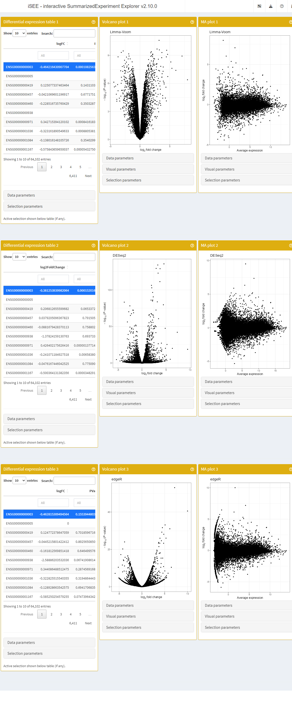
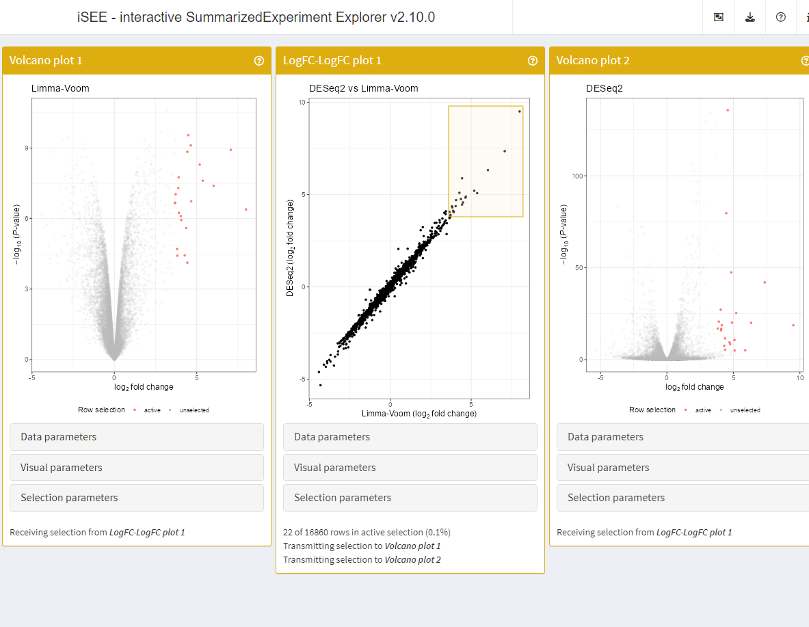

# Supported differential expression methods

## Implementation

### User-facing storage and access

Differential expression results are generally reported as tables of
statistics, including (log₂) fold-change, p-value, average expression,
etc.

Those statistics being reported for individual features (e.g., genes),
the
[`rowData()`](https://rdrr.io/pkg/SummarizedExperiment/man/SummarizedExperiment-class.html)
component of
[`SummarizedExperiment()`](https://rdrr.io/pkg/SummarizedExperiment/man/SummarizedExperiment-class.html)
objects provides a natural home for that information. Specifically,
*[iSEEde](https://bioconductor.org/packages/3.24/iSEEde)* stores and
retrieves differential expression results in `rowData(se)[["iSEEde"]]`.
However, the
[`rowData()`](https://rdrr.io/pkg/SummarizedExperiment/man/SummarizedExperiment-class.html)
function should not be used to access or edit that information. Instead,
the functions
[`embedContrastResults()`](https://isee.github.io/iSEEde/reference/utils-SummarizedExperiment.md)
and
[`contrastResults()`](https://isee.github.io/iSEEde/reference/contrastResults.md),
should be used to store and retrieve contrast results, respectively, as
those functions ensure that feature names are kept synchronised with the
enclosing `SummarizedExperiment` object.

Moreover, the function
[`contrastResultsNames()`](https://isee.github.io/iSEEde/reference/contrastResults.md)
can be used to retrieve the names of contrast available in a given
`SummarizedExperiment` object.

### Additional considerations

The first challenge arises when differential expression statistics are
computed only for a subset of features. In that case,
[`embedContrastResults()`](https://isee.github.io/iSEEde/reference/utils-SummarizedExperiment.md)
populates missing information with `NA` values.

The second challenge arises from the different names of columns used by
individual differential expression methods to store differential
expression common statistics. To address this,
*[iSEEde](https://bioconductor.org/packages/3.24/iSEEde)* provides S4
classes creating a common interface to supported differential expression
methods. Each class of differential expression results implements the
following methods:

- [`pValue()`](https://isee.github.io/iSEEde/reference/de-generics.md)
  returns the vector of raw p-values.
- [`log2FoldChange()`](https://isee.github.io/iSEEde/reference/de-generics.md)
  returns the vector of log2-fold-change values.
- [`averageLog2()`](https://isee.github.io/iSEEde/reference/de-generics.md)
  returns the vector of average log2-expression values.

## Example data

In this example, we use the
[`?airway`](https://rdrr.io/pkg/airway/man/airway.html) data set.

We briefly adjust the reference level of the treatment factor to the
untreated condition.

\
[`library`](https://rdrr.io/r/base/library.html)`(``"airway"``)`\
[`data`](https://rdrr.io/r/utils/data.html)`(``"airway"``)`\
`airway``$``dex`` ``<-`` `[`relevel`](https://rdrr.io/r/stats/relevel.html)`(``airway``$``dex``, ``"untrt"``)`

## Supported methods

### Limma

We first use
[`edgeR::filterByExpr()`](https://rdrr.io/pkg/edgeR/man/filterByExpr.html)
to remove genes whose counts are too low to support a rigorous
differential expression analysis. Then we run a standard Limma-Voom
analysis using `edgeR::voomLmFit()`,
[`limma::makeContrasts()`](https://rdrr.io/pkg/limma/man/makeContrasts.html),
and [`limma::eBayes()`](https://rdrr.io/pkg/limma/man/ebayes.html).
(Alternatively, we could have used
[`limma::treat()`](https://rdrr.io/pkg/limma/man/ebayes.html) instead of
[`limma::eBayes()`](https://rdrr.io/pkg/limma/man/ebayes.html).)

The linear model includes the `dex` and `cell` covariates, indicating
the treatment conditions and cell types, respectively. Here, we are
interested in differences between treatments, adjusted by cell type, and
define this comparison as the `dextrt - dexuntrt` contrast.

The final differential expression results are fetched using
[`limma::topTable()`](https://rdrr.io/pkg/limma/man/toptable.html).

\
[`library`](https://rdrr.io/r/base/library.html)`(`[`"edgeR"`](https://bioinf.wehi.edu.au/edgeR/)`)`\
\
`design`` ``<-`` `[`model.matrix`](https://rdrr.io/r/stats/model.matrix.html)`(``~`` ``0`` ``+`` ``dex`` ``+`` ``cell``, data ``=`` `[`colData`](https://rdrr.io/pkg/SummarizedExperiment/man/SummarizedExperiment-class.html)`(``airway``)``)`\
\
`keep`` ``<-`` `[`filterByExpr`](https://rdrr.io/pkg/edgeR/man/filterByExpr.html)`(``airway``, ``design``)`\
`fit`` ``<-`` `[`voomLmFit`](https://rdrr.io/pkg/limma/man/voomLmFit.html)`(``airway``[``keep``, ``]``, ``design``, plot ``=`` ``FALSE``)`\
`contr`` ``<-`` `[`makeContrasts`](https://rdrr.io/pkg/limma/man/makeContrasts.html)`(``"dextrt - dexuntrt"``, levels ``=`` ``design``)`\
`fit`` ``<-`` `[`contrasts.fit`](https://rdrr.io/pkg/limma/man/contrasts.fit.html)`(``fit``, ``contr``)`\
`fit`` ``<-`` `[`eBayes`](https://rdrr.io/pkg/limma/man/ebayes.html)`(``fit``)`\
`res_limma`` ``<-`` `[`topTable`](https://rdrr.io/pkg/limma/man/toptable.html)`(``fit``, sort.by ``=`` ``"P"``, n ``=`` ``Inf``)`\
[`head`](https://rdrr.io/r/utils/head.html)`(``res_limma``)`\
`#>                         gene_id gene_name entrezid   gene_biotype gene_seq_start gene_seq_end`\
`#> ENSG00000165995 ENSG00000165995    CACNB2       NA protein_coding       18429606     18830798`\
`#> ENSG00000120129 ENSG00000120129     DUSP1       NA protein_coding      172195093    172198198`\
`#> ENSG00000146250 ENSG00000146250    PRSS35       NA protein_coding       84222194     84235423`\
`#> ENSG00000189221 ENSG00000189221      MAOA       NA protein_coding       43515467     43606068`\
`#> ENSG00000152583 ENSG00000152583   SPARCL1       NA protein_coding       88394487     88452213`\
`#> ENSG00000157214 ENSG00000157214    STEAP2       NA protein_coding       89796904     89867451`\
`#>                 seq_name seq_strand seq_coord_system  symbol     logFC  AveExpr         t`\
`#> ENSG00000165995       10          1               NA  CACNB2  3.205585 3.682244  37.81643`\
`#> ENSG00000120129        5         -1               NA   DUSP1  2.864798 6.644455  28.50912`\
`#> ENSG00000146250        6          1               NA  PRSS35 -2.828191 3.224885 -28.23203`\
`#> ENSG00000189221        X          1               NA    MAOA  3.257594 5.950559  27.69288`\
`#> ENSG00000152583        4         -1               NA SPARCL1  4.489181 4.166904  27.40418`\
`#> ENSG00000157214        7          1               NA  STEAP2  1.894503 6.790009  27.34493`\
`#>                      P.Value    adj.P.Val        B`\
`#> ENSG00000165995 1.053353e-10 1.775953e-06 14.49959`\
`#> ENSG00000120129 1.119656e-09 4.051142e-06 13.02968`\
`#> ENSG00000146250 1.214760e-09 4.051142e-06 12.49617`\
`#> ENSG00000189221 1.426822e-09 4.051142e-06 12.78445`\
`#> ENSG00000152583 1.557181e-09 4.051142e-06 12.37046`\
`#> ENSG00000157214 1.585550e-09 4.051142e-06 12.71268`

Then, we embed this set of differential expression results in the
`airway` object using the
[`embedContrastResults()`](https://isee.github.io/iSEEde/reference/utils-SummarizedExperiment.md)
method.

Because the output of
[`limma::topTable()`](https://rdrr.io/pkg/limma/man/toptable.html) is a
standard `data.frame`, the `class=` argument must be used to manually
identify the method that produced those results.

Supported classes are listed in the object
[`iSEEde::embedContrastResultsMethods`](https://isee.github.io/iSEEde/reference/utils-SummarizedExperiment.md),
i.e.

\
[`library`](https://rdrr.io/r/base/library.html)`(`[`iSEEde`](https://github.com/iSEE/iSEEde)`)`\
`embedContrastResultsMethods`\
`#>              limma `\
`#> "iSEELimmaResults"`

This manual method is preferable to any automated heuristic (e.g. using
the column names of the `data.frame` for identifying it as a
[`limma::topTable()`](https://rdrr.io/pkg/limma/man/toptable.html)
output).

The results embedded in the `airway` object can be accessed using the
[`contrastResults()`](https://isee.github.io/iSEEde/reference/contrastResults.md)
function.

\
`airway`` ``<-`` `[`embedContrastResults`](https://isee.github.io/iSEEde/reference/utils-SummarizedExperiment.md)`(``res_limma``, ``airway``, name ``=`` ``"Limma-Voom"``, class ``=`` ``"limma"``)`\
[`contrastResults`](https://isee.github.io/iSEEde/reference/contrastResults.md)`(``airway``)`\
`#> DataFrame with 63677 rows and 1 column`\
`#>                         Limma-Voom`\
`#>                 <iSEELimmaResults>`\
`#> ENSG00000000003 <iSEELimmaResults>`\
`#> ENSG00000000005 <iSEELimmaResults>`\
`#> ENSG00000000419 <iSEELimmaResults>`\
`#> ENSG00000000457 <iSEELimmaResults>`\
`#> ENSG00000000460 <iSEELimmaResults>`\
`#> ...                            ...`\
`#> ENSG00000273489 <iSEELimmaResults>`\
`#> ENSG00000273490 <iSEELimmaResults>`\
`#> ENSG00000273491 <iSEELimmaResults>`\
`#> ENSG00000273492 <iSEELimmaResults>`\
`#> ENSG00000273493 <iSEELimmaResults>`\
[`contrastResults`](https://isee.github.io/iSEEde/reference/contrastResults.md)`(``airway``, ``"Limma-Voom"``)`\
`#> iSEELimmaResults with 63677 rows and 16 columns`\
`#>                         gene_id   gene_name  entrezid   gene_biotype gene_seq_start gene_seq_end`\
`#>                     <character> <character> <integer>    <character>      <integer>    <integer>`\
`#> ENSG00000000003 ENSG00000000003      TSPAN6        NA protein_coding       99883667     99894988`\
`#> ENSG00000000005              NA          NA        NA             NA             NA           NA`\
`#> ENSG00000000419 ENSG00000000419        DPM1        NA protein_coding       49551404     49575092`\
`#> ENSG00000000457 ENSG00000000457       SCYL3        NA protein_coding      169818772    169863408`\
`#> ENSG00000000460 ENSG00000000460    C1orf112        NA protein_coding      169631245    169823221`\
`#> ...                         ...         ...       ...            ...            ...          ...`\
`#> ENSG00000273489              NA          NA        NA             NA             NA           NA`\
`#> ENSG00000273490              NA          NA        NA             NA             NA           NA`\
`#> ENSG00000273491              NA          NA        NA             NA             NA           NA`\
`#> ENSG00000273492              NA          NA        NA             NA             NA           NA`\
`#> ENSG00000273493              NA          NA        NA             NA             NA           NA`\
`#>                    seq_name seq_strand seq_coord_system      symbol      logFC   AveExpr         t`\
`#>                 <character>  <integer>        <integer> <character>  <numeric> <numeric> <numeric>`\
`#> ENSG00000000003           X         -1               NA      TSPAN6 -0.4640794   5.02559 -6.627486`\
`#> ENSG00000000005          NA         NA               NA          NA         NA        NA        NA`\
`#> ENSG00000000419          20         -1               NA        DPM1  0.1251282   4.60191  1.643118`\
`#> ENSG00000000457           1         -1               NA       SCYL3 -0.0420454   3.47269 -0.440210`\
`#> ENSG00000000460           1          1               NA    C1orf112 -0.2282190   1.40857 -0.980043`\
`#> ...                     ...        ...              ...         ...        ...       ...       ...`\
`#> ENSG00000273489          NA         NA               NA          NA         NA        NA        NA`\
`#> ENSG00000273490          NA         NA               NA          NA         NA        NA        NA`\
`#> ENSG00000273491          NA         NA               NA          NA         NA        NA        NA`\
`#> ENSG00000273492          NA         NA               NA          NA         NA        NA        NA`\
`#> ENSG00000273493          NA         NA               NA          NA         NA        NA        NA`\
`#>                    P.Value  adj.P.Val         B`\
`#>                  <numeric>  <numeric> <numeric>`\
`#> ENSG00000000003 0.00013017 0.00164997  0.947823`\
`#> ENSG00000000005         NA         NA        NA`\
`#> ENSG00000000419 0.13706950 0.24962106 -6.263296`\
`#> ENSG00000000457 0.67086001 0.77758145 -7.231174`\
`#> ENSG00000000460 0.35436323 0.49554924 -6.208629`\
`#> ...                    ...        ...       ...`\
`#> ENSG00000273489         NA         NA        NA`\
`#> ENSG00000273490         NA         NA        NA`\
`#> ENSG00000273491         NA         NA        NA`\
`#> ENSG00000273492         NA         NA        NA`\
`#> ENSG00000273493         NA         NA        NA`

### DESeq2

First, we use
[`DESeqDataSet()`](https://rdrr.io/pkg/DESeq2/man/DESeqDataSet.html) to
construct a `DESeqDataSet` object for the analysis. Then we run a
standard *[DESeq2](https://bioconductor.org/packages/3.24/DESeq2)*
analysis using [`DESeq()`](https://rdrr.io/pkg/DESeq2/man/DESeq.html).

The differential expression results are fetched using
[`results()`](https://rdrr.io/pkg/DESeq2/man/results.html).

\
[`library`](https://rdrr.io/r/base/library.html)`(`[`"DESeq2"`](https://github.com/thelovelab/DESeq2)`)`\
\
`dds`` ``<-`` `[`DESeqDataSet`](https://rdrr.io/pkg/DESeq2/man/DESeqDataSet.html)`(``airway``, ``~`` ``0`` ``+`` ``dex`` ``+`` ``cell``)`\
\
`dds`` ``<-`` `[`DESeq`](https://rdrr.io/pkg/DESeq2/man/DESeq.html)`(``dds``)`\
`res_deseq2`` ``<-`` `[`results`](https://rdrr.io/pkg/DESeq2/man/results.html)`(``dds``, contrast ``=`` `[`list`](https://rdrr.io/r/base/list.html)`(``"dextrt"``, ``"dexuntrt"``)``)`\
[`head`](https://rdrr.io/r/utils/head.html)`(``res_deseq2``)`\
`#> log2 fold change (MLE): dextrt vs dexuntrt `\
`#> Wald test p-value: dextrt vs dexuntrt `\
`#> DataFrame with 6 rows and 6 columns`\
`#>                   baseMean log2FoldChange     lfcSE      stat      pvalue       padj`\
`#>                  <numeric>      <numeric> <numeric> <numeric>   <numeric>  <numeric>`\
`#> ENSG00000000003 708.602170     -0.3812539  0.100654 -3.787752 0.000152016 0.00128292`\
`#> ENSG00000000005   0.000000             NA        NA        NA          NA         NA`\
`#> ENSG00000000419 520.297901      0.2068127  0.112219  1.842944 0.065337213 0.19646961`\
`#> ENSG00000000457 237.163037      0.0379205  0.143445  0.264356 0.791505314 0.91141884`\
`#> ENSG00000000460  57.932633     -0.0881679  0.287142 -0.307054 0.758802543 0.89500551`\
`#> ENSG00000000938   0.318098     -1.3782416  3.499906 -0.393794 0.693733216         NA`

Then, we embed this set of differential expression results in the
`airway` object using the
[`embedContrastResults()`](https://isee.github.io/iSEEde/reference/utils-SummarizedExperiment.md)
method.

In this instance, the
*[DESeq2](https://bioconductor.org/packages/3.24/DESeq2)* results are
stored in a recognisable
[`?DESeqResults`](https://rdrr.io/pkg/DESeq2/man/DESeqResults.html)
object, which can be given *as is* directly to the
[`embedContrastResults()`](https://isee.github.io/iSEEde/reference/utils-SummarizedExperiment.md)
method.

The function will automatically pass the results object to the
[`iSEEDESeq2Results()`](https://isee.github.io/iSEEde/reference/iSEEDESeq2Results-class.md)
constructor, to identify it as such.

The results embedded in the airway object can be accessed using the
[`contrastResults()`](https://isee.github.io/iSEEde/reference/contrastResults.md)
function.

\
`airway`` ``<-`` `[`embedContrastResults`](https://isee.github.io/iSEEde/reference/utils-SummarizedExperiment.md)`(``res_deseq2``, ``airway``, name ``=`` ``"DESeq2"``)`\
[`contrastResults`](https://isee.github.io/iSEEde/reference/contrastResults.md)`(``airway``)`\
`#> DataFrame with 63677 rows and 2 columns`\
`#>                         Limma-Voom              DESeq2`\
`#>                 <iSEELimmaResults> <iSEEDESeq2Results>`\
`#> ENSG00000000003 <iSEELimmaResults> <iSEEDESeq2Results>`\
`#> ENSG00000000005 <iSEELimmaResults> <iSEEDESeq2Results>`\
`#> ENSG00000000419 <iSEELimmaResults> <iSEEDESeq2Results>`\
`#> ENSG00000000457 <iSEELimmaResults> <iSEEDESeq2Results>`\
`#> ENSG00000000460 <iSEELimmaResults> <iSEEDESeq2Results>`\
`#> ...                            ...                 ...`\
`#> ENSG00000273489 <iSEELimmaResults> <iSEEDESeq2Results>`\
`#> ENSG00000273490 <iSEELimmaResults> <iSEEDESeq2Results>`\
`#> ENSG00000273491 <iSEELimmaResults> <iSEEDESeq2Results>`\
`#> ENSG00000273492 <iSEELimmaResults> <iSEEDESeq2Results>`\
`#> ENSG00000273493 <iSEELimmaResults> <iSEEDESeq2Results>`\
[`contrastResults`](https://isee.github.io/iSEEde/reference/contrastResults.md)`(``airway``, ``"DESeq2"``)`\
`#> iSEEDESeq2Results with 63677 rows and 6 columns`\
`#>                  baseMean log2FoldChange     lfcSE      stat      pvalue       padj`\
`#>                 <numeric>      <numeric> <numeric> <numeric>   <numeric>  <numeric>`\
`#> ENSG00000000003  708.6022     -0.3812539  0.100654 -3.787752 0.000152016 0.00128292`\
`#> ENSG00000000005    0.0000             NA        NA        NA          NA         NA`\
`#> ENSG00000000419  520.2979      0.2068127  0.112219  1.842944 0.065337213 0.19646961`\
`#> ENSG00000000457  237.1630      0.0379205  0.143445  0.264356 0.791505314 0.91141884`\
`#> ENSG00000000460   57.9326     -0.0881679  0.287142 -0.307054 0.758802543 0.89500551`\
`#> ...                   ...            ...       ...       ...         ...        ...`\
`#> ENSG00000273489  0.275899       1.483744   3.51398  0.422240    0.672850         NA`\
`#> ENSG00000273490  0.000000             NA        NA        NA          NA         NA`\
`#> ENSG00000273491  0.000000             NA        NA        NA          NA         NA`\
`#> ENSG00000273492  0.105978      -0.463688   3.52312 -0.131613    0.895290         NA`\
`#> ENSG00000273493  0.106142      -0.521372   3.53142 -0.147638    0.882628         NA`

### edgeR

We run a standard
*[edgeR](https://bioconductor.org/packages/3.24/edgeR)* analysis using
[`glmFit()`](https://rdrr.io/pkg/edgeR/man/glmfit.html) and
[`glmLRT()`](https://rdrr.io/pkg/edgeR/man/glmLRT.html).

The differential expression results are fetched using
[`topTags()`](https://rdrr.io/pkg/edgeR/man/topTags.html).

\
[`library`](https://rdrr.io/r/base/library.html)`(`[`"edgeR"`](https://bioinf.wehi.edu.au/edgeR/)`)`\
\
`design`` ``<-`` `[`model.matrix`](https://rdrr.io/r/stats/model.matrix.html)`(``~`` ``0`` ``+`` ``dex`` ``+`` ``cell``, data ``=`` `[`colData`](https://rdrr.io/pkg/SummarizedExperiment/man/SummarizedExperiment-class.html)`(``airway``)``)`\
\
`fit`` ``<-`` `[`glmFit`](https://rdrr.io/pkg/edgeR/man/glmfit.html)`(``airway``, ``design``, dispersion ``=`` ``0.1``)`\
`lrt`` ``<-`` `[`glmLRT`](https://rdrr.io/pkg/edgeR/man/glmLRT.html)`(``fit``, contrast ``=`` `[`c`](https://rdrr.io/r/base/c.html)`(``-``1``, ``1``, ``0``, ``0``, ``0``)``)`\
`res_edger`` ``<-`` `[`topTags`](https://rdrr.io/pkg/edgeR/man/topTags.html)`(``lrt``, n ``=`` ``Inf``)`\
[`head`](https://rdrr.io/r/utils/head.html)`(``res_edger``)`\
`#> Coefficient:  -1*dexuntrt 1*dextrt `\
`#>                         gene_id     gene_name entrezid         gene_biotype gene_seq_start`\
`#> ENSG00000109906 ENSG00000109906        ZBTB16       NA       protein_coding      113930315`\
`#> ENSG00000179593 ENSG00000179593       ALOX15B       NA       protein_coding        7942335`\
`#> ENSG00000127954 ENSG00000127954        STEAP4       NA       protein_coding       87905744`\
`#> ENSG00000152583 ENSG00000152583       SPARCL1       NA       protein_coding       88394487`\
`#> ENSG00000250978 ENSG00000250978 RP11-357D18.1       NA processed_transcript       66759637`\
`#> ENSG00000163884 ENSG00000163884         KLF15       NA       protein_coding      126061478`\
`#>                 gene_seq_end seq_name seq_strand seq_coord_system        symbol`\
`#> ENSG00000109906    114121398       11          1               NA        ZBTB16`\
`#> ENSG00000179593      7952452       17          1               NA       ALOX15B`\
`#> ENSG00000127954     87936206        7         -1               NA        STEAP4`\
`#> ENSG00000152583     88452213        4         -1               NA       SPARCL1`\
`#> ENSG00000250978     66771420        5         -1               NA RP11-357D18.1`\
`#> ENSG00000163884    126076285        3         -1               NA         KLF15`\
`#>                 iSEEde.Limma-Voom.gene_id iSEEde.Limma-Voom.gene_name iSEEde.Limma-Voom.entrezid`\
`#> ENSG00000109906           ENSG00000109906                      ZBTB16                         NA`\
`#> ENSG00000179593           ENSG00000179593                     ALOX15B                         NA`\
`#> ENSG00000127954           ENSG00000127954                      STEAP4                         NA`\
`#> ENSG00000152583           ENSG00000152583                     SPARCL1                         NA`\
`#> ENSG00000250978           ENSG00000250978               RP11-357D18.1                         NA`\
`#> ENSG00000163884           ENSG00000163884                       KLF15                         NA`\
`#>                 iSEEde.Limma-Voom.gene_biotype iSEEde.Limma-Voom.gene_seq_start`\
`#> ENSG00000109906                 protein_coding                        113930315`\
`#> ENSG00000179593                 protein_coding                          7942335`\
`#> ENSG00000127954                 protein_coding                         87905744`\
`#> ENSG00000152583                 protein_coding                         88394487`\
`#> ENSG00000250978           processed_transcript                         66759637`\
`#> ENSG00000163884                 protein_coding                        126061478`\
`#>                 iSEEde.Limma-Voom.gene_seq_end iSEEde.Limma-Voom.seq_name`\
`#> ENSG00000109906                      114121398                         11`\
`#> ENSG00000179593                        7952452                         17`\
`#> ENSG00000127954                       87936206                          7`\
`#> ENSG00000152583                       88452213                          4`\
`#> ENSG00000250978                       66771420                          5`\
`#> ENSG00000163884                      126076285                          3`\
`#>                 iSEEde.Limma-Voom.seq_strand iSEEde.Limma-Voom.seq_coord_system`\
`#> ENSG00000109906                            1                                 NA`\
`#> ENSG00000179593                            1                                 NA`\
`#> ENSG00000127954                           -1                                 NA`\
`#> ENSG00000152583                           -1                                 NA`\
`#> ENSG00000250978                           -1                                 NA`\
`#> ENSG00000163884                           -1                                 NA`\
`#>                 iSEEde.Limma-Voom.symbol iSEEde.Limma-Voom.logFC iSEEde.Limma-Voom.AveExpr`\
`#> ENSG00000109906                   ZBTB16                7.053991                 1.3807218`\
`#> ENSG00000179593                  ALOX15B                7.988586                -1.4798754`\
`#> ENSG00000127954                   STEAP4                5.190278                 1.6193300`\
`#> ENSG00000152583                  SPARCL1                4.489181                 4.1669039`\
`#> ENSG00000250978            RP11-357D18.1                6.029003                -0.7521822`\
`#> ENSG00000163884                    KLF15                4.432748                 3.2401058`\
`#>                 iSEEde.Limma-Voom.t iSEEde.Limma-Voom.P.Value iSEEde.Limma-Voom.adj.P.Val`\
`#> ENSG00000109906            23.46389              5.671912e-09                5.112088e-06`\
`#> ENSG00000179593            20.63647              2.297454e-06                1.247956e-04`\
`#> ENSG00000127954            20.09410              2.051297e-08                9.637323e-06`\
`#> ENSG00000152583            27.40418              1.557181e-09                4.051142e-06`\
`#> ENSG00000250978            15.79062              1.489918e-07                2.415387e-05`\
`#> ENSG00000163884            22.92094              6.889824e-09                5.112088e-06`\
`#>                 iSEEde.Limma-Voom.B iSEEde.DESeq2.baseMean iSEEde.DESeq2.log2FoldChange`\
`#> ENSG00000109906            8.403255              385.07103                     7.352629`\
`#> ENSG00000179593            2.696302               67.24305                     9.505983`\
`#> ENSG00000127954            9.378244              286.38412                     5.207161`\
`#> ENSG00000152583           12.370460              997.43977                     4.574919`\
`#> ENSG00000250978            5.713613               56.31819                     6.327386`\
`#> ENSG00000163884           10.915033              561.10717                     4.459129`\
`#>                 iSEEde.DESeq2.lfcSE iSEEde.DESeq2.stat iSEEde.DESeq2.pvalue iSEEde.DESeq2.padj`\
`#> ENSG00000109906           0.5363902          13.707612         9.141717e-43       2.256376e-40`\
`#> ENSG00000179593           1.0545033           9.014654         1.974926e-19       1.252965e-17`\
`#> ENSG00000127954           0.4930839          10.560396         4.547384e-26       5.057701e-24`\
`#> ENSG00000152583           0.1840561          24.856114        2.220777e-136      4.001395e-132`\
`#> ENSG00000250978           0.6777980           9.335209         1.007922e-20       7.206645e-19`\
`#> ENSG00000163884           0.2348638          18.986019         2.225778e-80       2.506504e-77`\
`#>                     logFC   logCPM       LR       PValue          FDR`\
`#> ENSG00000109906  7.183385 4.132638 238.3947 8.805179e-54 5.606874e-49`\
`#> ENSG00000179593 10.015847 1.627629 181.0331 2.883024e-41 9.179116e-37`\
`#> ENSG00000127954  5.087069 3.672567 146.9725 7.957020e-34 1.688931e-29`\
`#> ENSG00000152583  4.498698 5.510213 140.2205 2.382274e-32 3.792402e-28`\
`#> ENSG00000250978  6.128131 1.377260 137.4681 9.526183e-32 1.213198e-27`\
`#> ENSG00000163884  4.367962 4.681216 129.2203 6.069471e-30 6.441428e-26`

Then, we embed this set of differential expression results in the
`airway` object using the
[`embedContrastResults()`](https://isee.github.io/iSEEde/reference/utils-SummarizedExperiment.md)
method.

In this instance, the
*[edgeR](https://bioconductor.org/packages/3.24/edgeR)* results are
stored in a recognisable `?TopTags` object. As such, the results object
can be given *as is* directly to the
[`embedContrastResults()`](https://isee.github.io/iSEEde/reference/utils-SummarizedExperiment.md)
method. The function will automatically pass the results object to the
[`iSEEedgeRResults()`](https://isee.github.io/iSEEde/reference/iSEEedgeRResults-class.md)
constructor, to identify it as such.

The results embedded in the airway object can be accessed using the
[`contrastResults()`](https://isee.github.io/iSEEde/reference/contrastResults.md)
function.

\
`airway`` ``<-`` `[`embedContrastResults`](https://isee.github.io/iSEEde/reference/utils-SummarizedExperiment.md)`(``res_edger``, ``airway``, name ``=`` ``"edgeR"``)`\
[`contrastResults`](https://isee.github.io/iSEEde/reference/contrastResults.md)`(``airway``)`\
`#> DataFrame with 63677 rows and 3 columns`\
`#>                         Limma-Voom              DESeq2              edgeR`\
`#>                 <iSEELimmaResults> <iSEEDESeq2Results> <iSEEedgeRResults>`\
`#> ENSG00000000003 <iSEELimmaResults> <iSEEDESeq2Results> <iSEEedgeRResults>`\
`#> ENSG00000000005 <iSEELimmaResults> <iSEEDESeq2Results> <iSEEedgeRResults>`\
`#> ENSG00000000419 <iSEELimmaResults> <iSEEDESeq2Results> <iSEEedgeRResults>`\
`#> ENSG00000000457 <iSEELimmaResults> <iSEEDESeq2Results> <iSEEedgeRResults>`\
`#> ENSG00000000460 <iSEELimmaResults> <iSEEDESeq2Results> <iSEEedgeRResults>`\
`#> ...                            ...                 ...                ...`\
`#> ENSG00000273489 <iSEELimmaResults> <iSEEDESeq2Results> <iSEEedgeRResults>`\
`#> ENSG00000273490 <iSEELimmaResults> <iSEEDESeq2Results> <iSEEedgeRResults>`\
`#> ENSG00000273491 <iSEELimmaResults> <iSEEDESeq2Results> <iSEEedgeRResults>`\
`#> ENSG00000273492 <iSEELimmaResults> <iSEEDESeq2Results> <iSEEedgeRResults>`\
`#> ENSG00000273493 <iSEELimmaResults> <iSEEDESeq2Results> <iSEEedgeRResults>`\
[`contrastResults`](https://isee.github.io/iSEEde/reference/contrastResults.md)`(``airway``, ``"edgeR"``)`\
`#> iSEEedgeRResults with 63677 rows and 5 columns`\
`#>                      logFC    logCPM        LR    PValue       FDR`\
`#>                  <numeric> <numeric> <numeric> <numeric> <numeric>`\
`#> ENSG00000000003 -0.4628153   5.05930  2.018481  0.155394         1`\
`#> ENSG00000000005  0.0000000  -3.45546  0.000000  1.000000         1`\
`#> ENSG00000000419  0.1247724   4.60783  0.146545  0.701860         1`\
`#> ENSG00000000457 -0.0445216   3.48326  0.018241  0.892565         1`\
`#> ENSG00000000460 -0.1618126   1.48518  0.210342  0.646500         1`\
`#> ...                    ...       ...       ...       ...       ...`\
`#> ENSG00000273489    2.48209  -3.28549   3.02143  0.082171         1`\
`#> ENSG00000273490    0.00000  -3.45546   0.00000  1.000000         1`\
`#> ENSG00000273491    0.00000  -3.45546   0.00000  1.000000         1`\
`#> ENSG00000273492   -1.24012  -3.36894   0.91097  0.339857         1`\
`#> ENSG00000273493   -1.75243  -3.36862   1.57193  0.209928         1`

## Live app

In this example, we used the
*[iSEEde](https://bioconductor.org/packages/3.24/iSEEde)* functions
[`DETable()`](https://isee.github.io/iSEEde/reference/DETable-class.md),
[`VolcanoPlot()`](https://isee.github.io/iSEEde/reference/VolcanoPlot-class.md),
and
[`MAPlot()`](https://isee.github.io/iSEEde/reference/MAPlot-class.md) to
add panels that facilitate the visualisation of differential expression
results in an *[iSEE](https://bioconductor.org/packages/3.24/iSEE)* app.

Specifically, we add one set of panels for each differential expression
method used in this vignette (i.e., Limma-Voom, DESeq2, edgeR).

\
[`library`](https://rdrr.io/r/base/library.html)`(`[`iSEE`](https://isee.github.io/iSEE/)`)`\
`app`` ``<-`` `[`iSEE`](https://isee.github.io/iSEE/reference/iSEE.html)`(``airway``, initial ``=`` `[`list`](https://rdrr.io/r/base/list.html)`(`\
`  `[`DETable`](https://isee.github.io/iSEEde/reference/DETable-class.md)`(``ContrastName``=``"Limma-Voom"``, HiddenColumns ``=`` `[`c`](https://rdrr.io/r/base/c.html)`(``"AveExpr"``, `\
`    ``"t"``, ``"B"``)``, PanelWidth ``=`` ``4L``)``,`\
`  `[`VolcanoPlot`](https://isee.github.io/iSEEde/reference/VolcanoPlot-class.md)`(``ContrastName ``=`` ``"Limma-Voom"``, PanelWidth ``=`` ``4L``)``,`\
`  `[`MAPlot`](https://isee.github.io/iSEEde/reference/MAPlot-class.md)`(``ContrastName ``=`` ``"Limma-Voom"``, PanelWidth ``=`` ``4L``)``,`\
`  `[`DETable`](https://isee.github.io/iSEEde/reference/DETable-class.md)`(``ContrastName``=``"DESeq2"``, HiddenColumns ``=`` `[`c`](https://rdrr.io/r/base/c.html)`(``"baseMean"``, `\
`    ``"lfcSE"``, ``"stat"``)``, PanelWidth ``=`` ``4L``)``,`\
`  `[`VolcanoPlot`](https://isee.github.io/iSEEde/reference/VolcanoPlot-class.md)`(``ContrastName ``=`` ``"DESeq2"``, PanelWidth ``=`` ``4L``)``,`\
`  `[`MAPlot`](https://isee.github.io/iSEEde/reference/MAPlot-class.md)`(``ContrastName ``=`` ``"DESeq2"``, PanelWidth ``=`` ``4L``)``,`\
`  `[`DETable`](https://isee.github.io/iSEEde/reference/DETable-class.md)`(``ContrastName``=``"edgeR"``, HiddenColumns ``=`` `[`c`](https://rdrr.io/r/base/c.html)`(``"logCPM"``, `\
`    ``"LR"``)``, PanelWidth ``=`` ``4L``)``,`\
`  `[`VolcanoPlot`](https://isee.github.io/iSEEde/reference/VolcanoPlot-class.md)`(``ContrastName ``=`` ``"edgeR"``, PanelWidth ``=`` ``4L``)``,`\
`  `[`MAPlot`](https://isee.github.io/iSEEde/reference/MAPlot-class.md)`(``ContrastName ``=`` ``"edgeR"``, PanelWidth ``=`` ``4L``)`\
`)``)`\
\
`if`` ``(`[`interactive`](https://rdrr.io/r/base/interactive.html)`(``)``)`` ``{`\
`  ``shiny``::`[`runApp`](https://rdrr.io/pkg/shiny/man/runApp.html)`(``app``)`\
`}`

## Comparing two contrasts

The
[`?LogFCLogFCPlot`](https://isee.github.io/iSEEde/reference/LogFCLogFCPlot-class.md)
class allows users to compare the log₂ fold-change value of features
between two differential expression contrasts.

In this example, we add one
[`?LogFCLogFCPlot`](https://isee.github.io/iSEEde/reference/LogFCLogFCPlot-class.md)
panel comparing the same contrast using the Limma-Voom and DESeq2
methods, alongside one
[`?VolcanoPlot`](https://isee.github.io/iSEEde/reference/VolcanoPlot-class.md)
panel for each of those two contrasts. Moreover, we pre-select an area
of the
[`?LogFCLogFCPlot`](https://isee.github.io/iSEEde/reference/LogFCLogFCPlot-class.md)
and highlight the selected features in the two
[`?VolcanoPlot`](https://isee.github.io/iSEEde/reference/VolcanoPlot-class.md)
panels.

\
[`library`](https://rdrr.io/r/base/library.html)`(`[`iSEE`](https://isee.github.io/iSEE/)`)`\
`app`` ``<-`` `[`iSEE`](https://isee.github.io/iSEE/reference/iSEE.html)`(``airway``, initial ``=`` `[`list`](https://rdrr.io/r/base/list.html)`(`\
`    `[`VolcanoPlot`](https://isee.github.io/iSEEde/reference/VolcanoPlot-class.md)`(``ContrastName``=``"Limma-Voom"``,`\
`        RowSelectionSource ``=`` ``"LogFCLogFCPlot1"``, ColorBy ``=`` ``"Row selection"``,`\
`        PanelWidth ``=`` ``4L``)``,`\
`    `[`LogFCLogFCPlot`](https://isee.github.io/iSEEde/reference/LogFCLogFCPlot-class.md)`(``ContrastNameX``=``"Limma-Voom"``, ContrastNameY``=``"DESeq2"``,`\
`        BrushData ``=`` `[`list`](https://rdrr.io/r/base/list.html)`(`\
`        xmin ``=`` ``3.6``, xmax ``=`` ``8.2``, ymin ``=`` ``3.8``, ymax ``=`` ``9.8``,`\
`        mapping ``=`` `[`list`](https://rdrr.io/r/base/list.html)`(``x ``=`` ``"X"``, y ``=`` ``"Y"``)``,`\
`        direction ``=`` ``"xy"``, brushId ``=`` ``"LogFCLogFCPlot1_Brush"``, `\
`        outputId ``=`` ``"LogFCLogFCPlot1"``)``,`\
`        PanelWidth ``=`` ``4L``)``,`\
`    `[`VolcanoPlot`](https://isee.github.io/iSEEde/reference/VolcanoPlot-class.md)`(``ContrastName``=``"DESeq2"``,`\
`        RowSelectionSource ``=`` ``"LogFCLogFCPlot1"``, ColorBy ``=`` ``"Row selection"``,`\
`        PanelWidth ``=`` ``4L``)`\
`)``)`\
\
`if`` ``(`[`interactive`](https://rdrr.io/r/base/interactive.html)`(``)``)`` ``{`\
`  ``shiny``::`[`runApp`](https://rdrr.io/pkg/shiny/man/runApp.html)`(``app``)`\
`}`

## Reproducibility

The *[iSEEde](https://bioconductor.org/packages/3.24/iSEEde)* package
(Rue-Albrecht, 2024) was made possible thanks to:

- R (R Core Team, 2026)
- *[BiocStyle](https://bioconductor.org/packages/3.24/BiocStyle)* (Oleś,
  2026)
- *[knitr](https://CRAN.R-project.org/package=knitr)* (Xie, 2026)
- *[RefManageR](https://CRAN.R-project.org/package=RefManageR)* (McLean,
  2017)
- *[rmarkdown](https://CRAN.R-project.org/package=rmarkdown)* (Allaire,
  Xie, Dervieux, McPherson, Luraschi, Ushey, Atkins, Wickham, Cheng,
  Chang, and Iannone, 2026)
- *[sessioninfo](https://CRAN.R-project.org/package=sessioninfo)*
  (Wickham, Chang, Flight, Müller, and Hester, 2026)
- *[testthat](https://CRAN.R-project.org/package=testthat)* (Wickham,
  2011)

This package was developed using
*[biocthis](https://bioconductor.org/packages/3.24/biocthis)*.

Code for creating the vignette

\
`## Create the vignette`\
[`library`](https://rdrr.io/r/base/library.html)`(`[`"rmarkdown"`](https://github.com/rstudio/rmarkdown)`)`\
[`system.time`](https://rdrr.io/r/base/system.time.html)`(`[`render`](https://pkgs.rstudio.com/rmarkdown/reference/render.html)`(``"methods.Rmd"``, ``"BiocStyle::html_document"``)``)`\
\
`## Extract the R code`\
[`library`](https://rdrr.io/r/base/library.html)`(`[`"knitr"`](https://yihui.org/knitr/)`)`\
[`knit`](https://rdrr.io/pkg/knitr/man/knit.html)`(``"methods.Rmd"``, tangle ``=`` ``TRUE``)`

Date the vignette was generated.

    #> [1] "2026-10-22 13:57:10 UTC"

Wallclock time spent generating the vignette.

    #> Time difference of 19.414 secs

`R` session information.

    #> ─ Session info ───────────────────────────────────────────────────────────────────────────────────────────────────────
    #>  setting  value
    #>  version  R version 4.6.1 (2026-06-24)
    #>  os       Ubuntu 24.04.5 LTS
    #>  system   x86_64, linux-gnu
    #>  ui       X11
    #>  language en
    #>  collate  en_US.UTF-8
    #>  ctype    en_US.UTF-8
    #>  tz       UTC
    #>  date     2026-10-22
    #>  pandoc   3.12.1 @ /usr/bin/ (via rmarkdown)
    #>  quarto   1.10.18 @ /usr/local/bin/quarto
    #> 
    #> ─ Packages ───────────────────────────────────────────────────────────────────────────────────────────────────────────
    #>  package              * version  date (UTC) lib source
    #>  abind                  1.4-8    2024-09-12 [1] RSPM (R 4.6.0)
    #>  airway               * 1.33.2   2026-07-21 [1] Bioconductor 3.24 (R 4.6.1)
    #>  bibtex                 0.5.3    2026-09-22 [1] RSPM (R 4.6.0)
    #>  Biobase              * 2.73.2   2026-07-29 [1] Bioconductor 3.24 (R 4.6.1)
    #>  BiocGenerics         * 0.59.12  2026-08-11 [1] Bioconductor 3.24 (R 4.6.1)
    #>  BiocManager            1.30.27  2025-11-14 [2] CRAN (R 4.6.1)
    #>  BiocParallel           1.47.0   2026-04-28 [1] Bioconductor 3.24 (R 4.6.1)
    #>  BiocStyle            * 2.41.0   2026-04-28 [1] Bioconductor 3.24 (R 4.6.1)
    #>  bookdown               0.48     2026-08-28 [1] RSPM (R 4.6.0)
    #>  bslib                  0.12.0   2026-08-04 [2] RSPM (R 4.6.0)
    #>  cachem                 1.1.0    2024-05-16 [2] RSPM (R 4.6.0)
    #>  circlize               0.4.18   2026-04-04 [1] RSPM (R 4.6.0)
    #>  cli                    3.6.6    2026-04-09 [2] RSPM (R 4.6.0)
    #>  clue                   0.3-68   2026-03-26 [1] RSPM (R 4.6.0)
    #>  cluster                2.1.8.3  2026-07-30 [2] RSPM (R 4.6.0)
    #>  codetools              0.2-20   2024-03-31 [3] CRAN (R 4.6.1)
    #>  colorspace             2.1-4    2026-10-08 [1] RSPM (R 4.6.0)
    #>  colourpicker           1.3.0    2023-08-21 [1] RSPM (R 4.6.0)
    #>  ComplexHeatmap         2.29.0   2026-04-28 [1] Bioconductor 3.24 (R 4.6.1)
    #>  crayon                 1.5.3    2024-06-20 [2] RSPM (R 4.6.0)
    #>  DelayedArray           0.39.8   2026-09-30 [1] Bioconductor 3.24 (R 4.6.1)
    #>  desc                   1.4.3    2023-12-10 [2] RSPM (R 4.6.0)
    #>  DESeq2               * 1.53.6   2026-10-02 [1] Bioconductor 3.24 (R 4.6.1)
    #>  digest                 0.6.39   2025-11-19 [2] RSPM (R 4.6.0)
    #>  doParallel             1.0.17   2022-02-07 [1] RSPM (R 4.6.0)
    #>  dplyr                  1.2.1    2026-04-03 [1] RSPM (R 4.6.0)
    #>  DT                     0.34.0   2025-09-02 [1] RSPM (R 4.6.0)
    #>  edgeR                * 4.99.10  2026-10-18 [1] Bioconductor 3.24 (R 4.6.1)
    #>  evaluate               1.0.5    2025-08-27 [2] RSPM (R 4.6.0)
    #>  farver                 2.1.2    2024-05-13 [1] RSPM (R 4.6.0)
    #>  fastmap                1.2.0    2024-05-15 [2] RSPM (R 4.6.0)
    #>  fontawesome            0.5.3    2024-11-16 [2] RSPM (R 4.6.0)
    #>  foreach                1.5.2    2022-02-02 [1] RSPM (R 4.6.0)
    #>  fs                     2.1.0    2026-04-18 [2] RSPM (R 4.6.0)
    #>  generics             * 0.1.4    2025-05-09 [1] RSPM (R 4.6.0)
    #>  GenomicRanges        * 1.65.4   2026-09-02 [1] Bioconductor 3.24 (R 4.6.1)
    #>  GetoptLong             1.1.1    2026-04-08 [1] RSPM (R 4.6.0)
    #>  ggplot2                4.0.3    2026-04-22 [1] RSPM (R 4.6.0)
    #>  ggrepel                0.9.8    2026-03-17 [1] RSPM (R 4.6.0)
    #>  GlobalOptions          0.1.4    2026-04-08 [1] RSPM (R 4.6.0)
    #>  glue                   1.8.1    2026-04-17 [2] RSPM (R 4.6.0)
    #>  gtable                 0.3.6    2024-10-25 [1] RSPM (R 4.6.0)
    #>  htmltools              0.5.9    2025-12-04 [2] RSPM (R 4.6.0)
    #>  htmlwidgets            1.6.4    2023-12-06 [2] RSPM (R 4.6.0)
    #>  httpuv                 1.6.17   2026-03-18 [2] RSPM (R 4.6.0)
    #>  httr                   1.4.9    2026-09-01 [1] RSPM (R 4.6.0)
    #>  igraph                 2.3.4    2026-09-30 [1] RSPM (R 4.6.0)
    #>  IRanges              * 2.47.5   2026-08-27 [1] Bioconductor 3.24 (R 4.6.1)
    #>  iSEE                 * 2.25.1   2026-07-13 [1] Bioconductor 3.24 (R 4.6.1)
    #>  iSEEde               * 1.11.0   2026-10-22 [1] Bioconductor
    #>  iterators              1.0.14   2022-02-05 [1] RSPM (R 4.6.0)
    #>  jquerylib              0.1.4    2021-04-26 [2] RSPM (R 4.6.0)
    #>  jsonlite               2.0.0    2025-03-27 [2] RSPM (R 4.6.0)
    #>  knitr                  1.52     2026-09-06 [2] RSPM (R 4.6.0)
    #>  later                  1.4.8    2026-03-05 [2] RSPM (R 4.6.0)
    #>  lattice                0.23-1   2026-08-12 [2] RSPM (R 4.6.0)
    #>  lifecycle              1.0.5    2026-01-08 [2] RSPM (R 4.6.0)
    #>  limma                * 3.99.2   2026-10-13 [1] Bioconductor 3.24 (R 4.6.1)
    #>  listviewer             4.0.0    2023-09-30 [1] RSPM (R 4.6.0)
    #>  locfit                 1.5-9.12 2025-03-05 [1] RSPM (R 4.6.0)
    #>  lubridate              1.9.5    2026-02-04 [1] RSPM (R 4.6.0)
    #>  magrittr               2.0.5    2026-04-04 [2] RSPM (R 4.6.0)
    #>  Matrix                 1.7-6    2026-07-25 [2] RSPM (R 4.6.0)
    #>  MatrixGenerics       * 1.25.0   2026-04-28 [1] Bioconductor 3.24 (R 4.6.1)
    #>  matrixStats          * 1.5.0    2025-01-07 [1] RSPM (R 4.6.0)
    #>  memoise                2.0.1    2021-11-26 [2] RSPM (R 4.6.0)
    #>  mgcv                   1.9-4    2025-11-07 [3] CRAN (R 4.6.1)
    #>  mime                   0.13     2025-03-17 [2] RSPM (R 4.6.0)
    #>  miniUI                 0.1.2    2025-04-17 [2] RSPM (R 4.6.0)
    #>  nlme                   3.1-171  2026-09-01 [2] RSPM (R 4.6.0)
    #>  otel                   0.2.0    2025-08-29 [2] RSPM (R 4.6.0)
    #>  pillar                 1.11.1   2025-09-17 [2] RSPM (R 4.6.0)
    #>  pkgconfig              2.0.3    2019-09-22 [2] RSPM (R 4.6.0)
    #>  pkgdown                2.2.1    2026-07-07 [2] RSPM (R 4.6.0)
    #>  plyr                   1.8.9    2023-10-02 [1] RSPM (R 4.6.0)
    #>  png                    0.1-9    2026-03-15 [1] RSPM (R 4.6.0)
    #>  promises               1.5.0    2025-11-01 [2] RSPM (R 4.6.0)
    #>  R6                     2.6.1    2025-02-15 [2] RSPM (R 4.6.0)
    #>  ragg                   1.5.2    2026-03-23 [2] RSPM (R 4.6.0)
    #>  RColorBrewer           1.1-3    2022-04-03 [1] RSPM (R 4.6.0)
    #>  Rcpp                   1.1.2    2026-07-05 [2] RSPM (R 4.6.0)
    #>  RefManageR           * 1.4.0    2022-09-30 [1] RSPM (R 4.6.0)
    #>  rintrojs               0.3.4    2024-01-11 [1] RSPM (R 4.6.0)
    #>  rjson                  0.2.23   2024-09-16 [1] RSPM (R 4.6.0)
    #>  rlang                  1.3.0    2026-07-05 [2] RSPM (R 4.6.0)
    #>  rmarkdown              2.32     2026-09-01 [2] RSPM (R 4.6.0)
    #>  S4Arrays               1.13.2   2026-09-30 [1] Bioconductor 3.24 (R 4.6.1)
    #>  S4Vectors            * 0.51.10  2026-09-16 [1] Bioconductor 3.24 (R 4.6.1)
    #>  S7                     0.2.2    2026-04-22 [1] RSPM (R 4.6.0)
    #>  sass                   0.4.10   2025-04-11 [2] RSPM (R 4.6.0)
    #>  scales                 1.4.0    2025-04-24 [1] RSPM (R 4.6.0)
    #>  Seqinfo              * 1.3.2    2026-08-27 [1] Bioconductor 3.24 (R 4.6.1)
    #>  sessioninfo          * 1.2.4    2026-06-04 [2] RSPM (R 4.6.0)
    #>  shape                  1.4.6.1  2024-02-23 [1] RSPM (R 4.6.0)
    #>  shiny                  1.14.0   2026-06-21 [2] RSPM (R 4.6.0)
    #>  shinyAce               0.4.4    2025-02-03 [1] RSPM (R 4.6.0)
    #>  shinydashboard         0.7.3    2025-04-21 [1] RSPM (R 4.6.0)
    #>  shinyjs                2.1.1    2026-01-15 [1] RSPM (R 4.6.0)
    #>  shinyWidgets           0.9.1    2026-03-09 [1] RSPM (R 4.6.0)
    #>  SingleCellExperiment * 1.35.2   2026-07-16 [1] Bioconductor 3.24 (R 4.6.1)
    #>  SparseArray            1.13.4   2026-09-30 [1] Bioconductor 3.24 (R 4.6.1)
    #>  statmod                1.5.2    2026-05-17 [1] RSPM (R 4.6.0)
    #>  stringi                1.8.9    2026-08-04 [2] RSPM (R 4.6.0)
    #>  stringr                1.6.0    2025-11-04 [1] RSPM (R 4.6.0)
    #>  SummarizedExperiment * 1.43.0   2026-04-28 [1] Bioconductor 3.24 (R 4.6.1)
    #>  systemfonts            1.3.2    2026-03-05 [2] RSPM (R 4.6.0)
    #>  textshaping            1.0.5    2026-03-06 [2] RSPM (R 4.6.0)
    #>  tibble                 3.3.1    2026-01-11 [2] RSPM (R 4.6.0)
    #>  tidyselect             1.2.1    2024-03-11 [1] RSPM (R 4.6.0)
    #>  timechange             0.4.0    2026-01-29 [1] RSPM (R 4.6.0)
    #>  vctrs                  0.7.3    2026-04-11 [2] RSPM (R 4.6.0)
    #>  vipor                  0.4.7    2023-12-18 [1] RSPM (R 4.6.0)
    #>  viridisLite            0.4.3    2026-02-04 [1] RSPM (R 4.6.0)
    #>  xfun                   0.62     2026-10-16 [2] RSPM (R 4.6.0)
    #>  xml2                   1.6.0    2026-06-22 [2] RSPM (R 4.6.0)
    #>  xtable                 1.8-8    2026-02-22 [2] RSPM (R 4.6.0)
    #>  XVector                0.53.0   2026-04-28 [1] Bioconductor 3.24 (R 4.6.1)
    #>  yaml                   2.3.12   2025-12-10 [2] RSPM (R 4.6.0)
    #> 
    #>  [1] /__w/_temp/Library
    #>  [2] /usr/local/lib/R/site-library
    #>  [3] /usr/local/lib/R/library
    #>  * ── Packages attached to the search path.
    #> 
    #> ──────────────────────────────────────────────────────────────────────────────────────────────────────────────────────

## Bibliography

This vignette was generated using
*[BiocStyle](https://bioconductor.org/packages/3.24/BiocStyle)*
`r Citep(bib[["BiocStyle"]])` with
*[knitr](https://CRAN.R-project.org/package=knitr)* (Xie, 2026) and
*[rmarkdown](https://CRAN.R-project.org/package=rmarkdown)* (Allaire,
Xie, Dervieux et al., 2026) running behind the scenes.

Citations made with
*[RefManageR](https://CRAN.R-project.org/package=RefManageR)* (McLean,
2017).

[\[1\]](#cite-allaire2026rmarkdown) J. Allaire, Y. Xie, C. Dervieux, et
al. *rmarkdown: Dynamic Documents for R*. R package version 2.32. 2026.
URL: <https://github.com/rstudio/rmarkdown>.

[\[2\]](#cite-mclean2017refmanager) M. W. McLean. “RefManageR: Import
and Manage BibTeX and BibLaTeX References in R”. In: *The Journal of
Open Source Software* (2017). DOI:
[10.21105/joss.00338](https://doi.org/10.21105/joss.00338).

[\[3\]](#cite-ole2026biocstyle) A. Oleś. *BiocStyle: Standard styles for
vignettes and other Bioconductor documents*. R package version 2.41.0.
2026. DOI:
[10.18129/B9.bioc.BiocStyle](https://doi.org/10.18129/B9.bioc.BiocStyle).
URL: <https://bioconductor.org/packages/BiocStyle>.

[\[4\]](#cite-2026language) R Core Team. *R: A Language and Environment
for Statistical Computing*. R Foundation for Statistical Computing (ROR:
\<<https://ror.org/05qewa988%3E>;). Vienna, Austria, 2026. DOI:
[10.32614/R.manuals](https://doi.org/10.32614/R.manuals). URL:
<https://www.R-project.org/>.

[\[5\]](#cite-ruealbrecht2024iseede) K. Rue-Albrecht. *iSEEde: iSEE
extension for panels related to differential expression analysis*. R
package version 1.11.0. 2024. URL: <https://github.com/iSEE/iSEEde>.

[\[6\]](#cite-wickham2011testthat) H. Wickham. “testthat: Get Started
with Testing”. In: *The R Journal* 3 (2011), pp. 5–10. URL:
<https://journal.r-project.org/articles/RJ-2011-002/>.

[\[7\]](#cite-wickham2026sessioninfo) H. Wickham, W. Chang, R. Flight,
et al. *sessioninfo: R Session Information*. R package version 1.2.4.
2026. URL: <https://sessioninfo.r-lib.org>.

[\[8\]](#cite-xie2026knitr) Y. Xie. *knitr: A General-Purpose Package
for Dynamic Report Generation in R*. R package version 1.52. 2026. URL:
<https://yihui.org/knitr/>.
