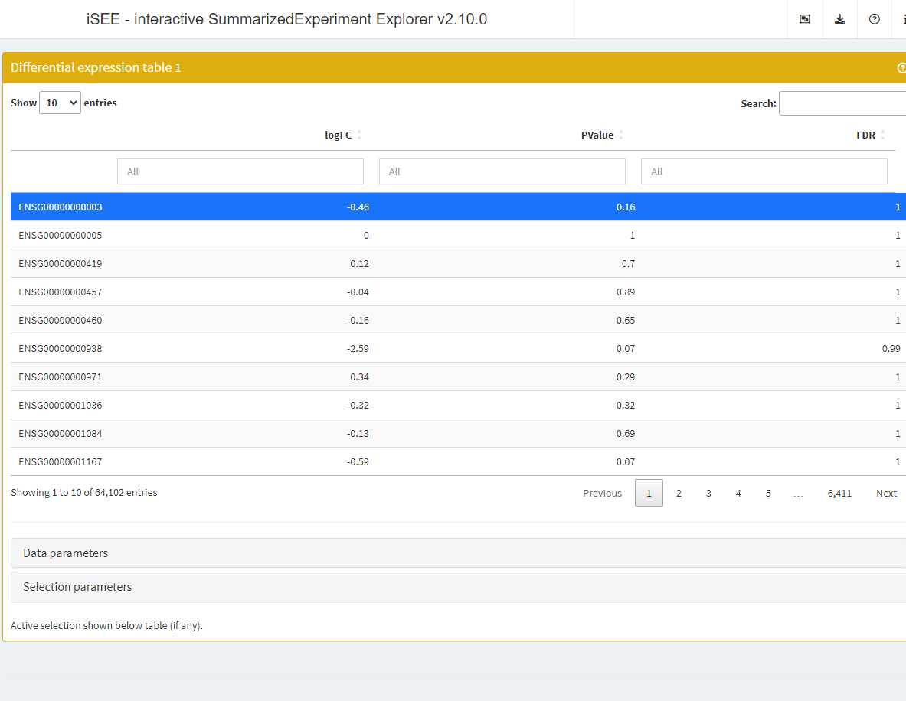
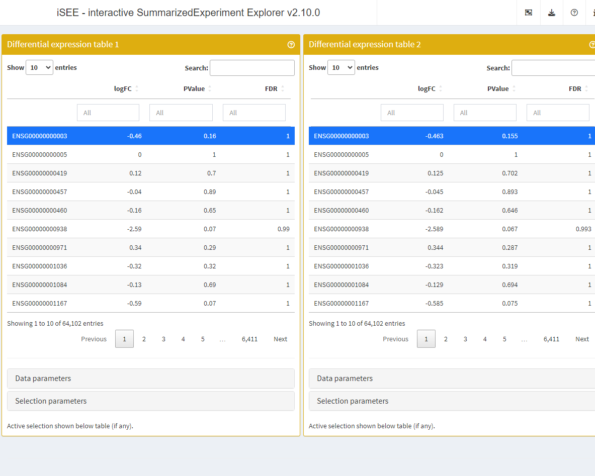

# Rounding numeric values

## Example data

In this example, we use the
[`?airway`](https://rdrr.io/pkg/airway/man/airway.html) data set.

We briefly adjust the reference level of the treatment factor to the
untreated condition.

\
[`library`](https://rdrr.io/r/base/library.html)`(``"airway"``)`\
[`data`](https://rdrr.io/r/utils/data.html)`(``"airway"``)`\
`airway``$``dex`` ``<-`` `[`relevel`](https://rdrr.io/r/stats/relevel.html)`(``airway``$``dex``, ``"untrt"``)`

## Differential expression

To generate some example results, we run a standard
*[edgeR](https://bioconductor.org/packages/3.24/edgeR)* analysis using
[`glmFit()`](https://rdrr.io/pkg/edgeR/man/glmfit.html) and
[`glmLRT()`](https://rdrr.io/pkg/edgeR/man/glmLRT.html).

The differential expression results are fetched using
[`topTags()`](https://rdrr.io/pkg/edgeR/man/topTags.html).

\
[`library`](https://rdrr.io/r/base/library.html)`(`[`"edgeR"`](https://bioinf.wehi.edu.au/edgeR/)`)`\
\
`design`` ``<-`` `[`model.matrix`](https://rdrr.io/r/stats/model.matrix.html)`(``~`` ``0`` ``+`` ``dex`` ``+`` ``cell``, data ``=`` `[`colData`](https://rdrr.io/pkg/SummarizedExperiment/man/SummarizedExperiment-class.html)`(``airway``)``)`\
\
`fit`` ``<-`` `[`glmFit`](https://rdrr.io/pkg/edgeR/man/glmfit.html)`(``airway``, ``design``, dispersion ``=`` ``0.1``)`\
`lrt`` ``<-`` `[`glmLRT`](https://rdrr.io/pkg/edgeR/man/glmLRT.html)`(``fit``, contrast ``=`` `[`c`](https://rdrr.io/r/base/c.html)`(``-``1``, ``1``, ``0``, ``0``, ``0``)``)`\
`res_edger`` ``<-`` `[`topTags`](https://rdrr.io/pkg/edgeR/man/topTags.html)`(``lrt``, n ``=`` ``Inf``)`\
[`head`](https://rdrr.io/r/utils/head.html)`(``res_edger``)`\
`#> Coefficient:  -1*dexuntrt 1*dextrt `\
`#>                         gene_id     gene_name entrezid         gene_biotype gene_seq_start`\
`#> ENSG00000109906 ENSG00000109906        ZBTB16       NA       protein_coding      113930315`\
`#> ENSG00000179593 ENSG00000179593       ALOX15B       NA       protein_coding        7942335`\
`#> ENSG00000127954 ENSG00000127954        STEAP4       NA       protein_coding       87905744`\
`#> ENSG00000152583 ENSG00000152583       SPARCL1       NA       protein_coding       88394487`\
`#> ENSG00000250978 ENSG00000250978 RP11-357D18.1       NA processed_transcript       66759637`\
`#> ENSG00000163884 ENSG00000163884         KLF15       NA       protein_coding      126061478`\
`#>                 gene_seq_end seq_name seq_strand seq_coord_system        symbol     logFC   logCPM`\
`#> ENSG00000109906    114121398       11          1               NA        ZBTB16  7.183385 4.132638`\
`#> ENSG00000179593      7952452       17          1               NA       ALOX15B 10.015847 1.627629`\
`#> ENSG00000127954     87936206        7         -1               NA        STEAP4  5.087069 3.672567`\
`#> ENSG00000152583     88452213        4         -1               NA       SPARCL1  4.498698 5.510213`\
`#> ENSG00000250978     66771420        5         -1               NA RP11-357D18.1  6.128131 1.377260`\
`#> ENSG00000163884    126076285        3         -1               NA         KLF15  4.367962 4.681216`\
`#>                       LR       PValue          FDR`\
`#> ENSG00000109906 238.3947 8.805179e-54 5.606874e-49`\
`#> ENSG00000179593 181.0331 2.883024e-41 9.179116e-37`\
`#> ENSG00000127954 146.9725 7.957020e-34 1.688931e-29`\
`#> ENSG00000152583 140.2205 2.382274e-32 3.792402e-28`\
`#> ENSG00000250978 137.4681 9.526183e-32 1.213198e-27`\
`#> ENSG00000163884 129.2203 6.069471e-30 6.441428e-26`

Then, we embed this set of differential expression results in the
`airway` object using the
[`embedContrastResults()`](https://isee.github.io/iSEEde/reference/utils-SummarizedExperiment.md)
method.

The results embedded in the airway object can be accessed using the
[`contrastResults()`](https://isee.github.io/iSEEde/reference/contrastResults.md)
function.

\
[`library`](https://rdrr.io/r/base/library.html)`(`[`iSEEde`](https://github.com/iSEE/iSEEde)`)`\
`airway`` ``<-`` `[`embedContrastResults`](https://isee.github.io/iSEEde/reference/utils-SummarizedExperiment.md)`(``res_edger``, ``airway``, name ``=`` ``"edgeR"``)`\
[`contrastResults`](https://isee.github.io/iSEEde/reference/contrastResults.md)`(``airway``)`\
`#> DataFrame with 63677 rows and 1 column`\
`#>                              edgeR`\
`#>                 <iSEEedgeRResults>`\
`#> ENSG00000000003 <iSEEedgeRResults>`\
`#> ENSG00000000005 <iSEEedgeRResults>`\
`#> ENSG00000000419 <iSEEedgeRResults>`\
`#> ENSG00000000457 <iSEEedgeRResults>`\
`#> ENSG00000000460 <iSEEedgeRResults>`\
`#> ...                            ...`\
`#> ENSG00000273489 <iSEEedgeRResults>`\
`#> ENSG00000273490 <iSEEedgeRResults>`\
`#> ENSG00000273491 <iSEEedgeRResults>`\
`#> ENSG00000273492 <iSEEedgeRResults>`\
`#> ENSG00000273493 <iSEEedgeRResults>`\
[`contrastResults`](https://isee.github.io/iSEEde/reference/contrastResults.md)`(``airway``, ``"edgeR"``)`\
`#> iSEEedgeRResults with 63677 rows and 5 columns`\
`#>                      logFC    logCPM        LR    PValue       FDR`\
`#>                  <numeric> <numeric> <numeric> <numeric> <numeric>`\
`#> ENSG00000000003 -0.4628153   5.05930  2.018481  0.155394         1`\
`#> ENSG00000000005  0.0000000  -3.45546  0.000000  1.000000         1`\
`#> ENSG00000000419  0.1247724   4.60783  0.146545  0.701860         1`\
`#> ENSG00000000457 -0.0445216   3.48326  0.018241  0.892565         1`\
`#> ENSG00000000460 -0.1618126   1.48518  0.210342  0.646500         1`\
`#> ...                    ...       ...       ...       ...       ...`\
`#> ENSG00000273489    2.48209  -3.28549   3.02143  0.082171         1`\
`#> ENSG00000273490    0.00000  -3.45546   0.00000  1.000000         1`\
`#> ENSG00000273491    0.00000  -3.45546   0.00000  1.000000         1`\
`#> ENSG00000273492   -1.24012  -3.36894   0.91097  0.339857         1`\
`#> ENSG00000273493   -1.75243  -3.36862   1.57193  0.209928         1`

## Set a default rounding configuration

Differential expression methods generally return precise numeric values
with several digits after the decimal point. This level of precision can
be unnecessarily overwhelming and users may wish to round numeric values
to a limited number of significant digits.

The builtin default configuration for rounding in
*[iSEEde](https://bioconductor.org/packages/3.24/iSEEde)* is
`RoundDigit = FALSE` and `SignifDigits = 3`. In other words, numeric
values are not rounded, and if users do activate the rounding
functionality, numeric values are rounded to three significant digits.

Those defaults can be changed using the
[`panelDefaults()`](https://isee.github.io/iSEE/reference/panelDefaults.html)
function.

\
[`panelDefaults`](https://isee.github.io/iSEE/reference/panelDefaults.html)`(``RoundDigits ``=`` ``TRUE``, SignifDigits ``=`` ``2L``)`

With the default panel settings configured, we use the
[`DETable()`](https://isee.github.io/iSEEde/reference/DETable-class.md)
function to display the contrast results with rounded numeric values.

\
[`library`](https://rdrr.io/r/base/library.html)`(`[`iSEE`](https://isee.github.io/iSEE/)`)`\
`app`` ``<-`` `[`iSEE`](https://isee.github.io/iSEE/reference/iSEE.html)`(``airway``, initial ``=`` `[`list`](https://rdrr.io/r/base/list.html)`(`\
`  `[`DETable`](https://isee.github.io/iSEEde/reference/DETable-class.md)`(``ContrastName``=``"edgeR"``, HiddenColumns ``=`` `[`c`](https://rdrr.io/r/base/c.html)`(``"logCPM"``, ``"LR"``)``,`\
`          PanelWidth ``=`` ``12L``)`\
`)``)`\
\
`if`` ``(`[`interactive`](https://rdrr.io/r/base/interactive.html)`(``)``)`` ``{`\
`  ``shiny``::`[`runApp`](https://rdrr.io/pkg/shiny/man/runApp.html)`(``app``)`\
`}`

## Configuring rounding in individual panels

The default rounding configuration can be overridden in individual panel
configurations.

The slots `RoundDigits` and `SignifDigits` can be set directly in the
individual calls to the
[`DETable()`](https://isee.github.io/iSEEde/reference/DETable-class.md)
constructor function.

In the example below, we add two tables, one rounding numeric values to
the default value of two significant digits set above, the other
rounding the same values to three significant digits.

\
[`library`](https://rdrr.io/r/base/library.html)`(`[`iSEE`](https://isee.github.io/iSEE/)`)`\
`app`` ``<-`` `[`iSEE`](https://isee.github.io/iSEE/reference/iSEE.html)`(``airway``, initial ``=`` `[`list`](https://rdrr.io/r/base/list.html)`(`\
`  `[`DETable`](https://isee.github.io/iSEEde/reference/DETable-class.md)`(``ContrastName``=``"edgeR"``, HiddenColumns ``=`` `[`c`](https://rdrr.io/r/base/c.html)`(``"logCPM"``, ``"LR"``)``,`\
`          PanelWidth ``=`` ``6L``, RoundDigits ``=`` ``TRUE``)``,`\
`  `[`DETable`](https://isee.github.io/iSEEde/reference/DETable-class.md)`(``ContrastName``=``"edgeR"``, HiddenColumns ``=`` `[`c`](https://rdrr.io/r/base/c.html)`(``"logCPM"``, ``"LR"``)``,`\
`          PanelWidth ``=`` ``6L``, RoundDigits ``=`` ``TRUE``, SignifDigits ``=`` ``3L``)`\
`)``)`\
\
`if`` ``(`[`interactive`](https://rdrr.io/r/base/interactive.html)`(``)``)`` ``{`\
`  ``shiny``::`[`runApp`](https://rdrr.io/pkg/shiny/man/runApp.html)`(``app``)`\
`}`

## Reproducibility

The *[iSEEde](https://bioconductor.org/packages/3.24/iSEEde)* package
(Rue-Albrecht, 2024) was made possible thanks to:

- R (R Core Team, 2026)
- *[BiocStyle](https://bioconductor.org/packages/3.24/BiocStyle)* (Oleś,
  2026)
- *[knitr](https://CRAN.R-project.org/package=knitr)* (Xie, 2026)
- *[RefManageR](https://CRAN.R-project.org/package=RefManageR)* (McLean,
  2017)
- *[rmarkdown](https://CRAN.R-project.org/package=rmarkdown)* (Allaire,
  Xie, Dervieux, McPherson, Luraschi, Ushey, Atkins, Wickham, Cheng,
  Chang, and Iannone, 2026)
- *[sessioninfo](https://CRAN.R-project.org/package=sessioninfo)*
  (Wickham, Chang, Flight, Müller, and Hester, 2026)
- *[testthat](https://CRAN.R-project.org/package=testthat)* (Wickham,
  2011)

This package was developed using
*[biocthis](https://bioconductor.org/packages/3.24/biocthis)*.

Code for creating the vignette

\
`## Create the vignette`\
[`library`](https://rdrr.io/r/base/library.html)`(`[`"rmarkdown"`](https://github.com/rstudio/rmarkdown)`)`\
[`system.time`](https://rdrr.io/r/base/system.time.html)`(`[`render`](https://pkgs.rstudio.com/rmarkdown/reference/render.html)`(``"rounding.Rmd"``, ``"BiocStyle::html_document"``)``)`\
\
`## Extract the R code`\
[`library`](https://rdrr.io/r/base/library.html)`(`[`"knitr"`](https://yihui.org/knitr/)`)`\
[`knit`](https://rdrr.io/pkg/knitr/man/knit.html)`(``"rounding.Rmd"``, tangle ``=`` ``TRUE``)`

Date the vignette was generated.

    #> [1] "2026-10-22 13:57:22 UTC"

Wallclock time spent generating the vignette.

    #> Time difference of 9.771 secs

`R` session information.

    #> ─ Session info ───────────────────────────────────────────────────────────────────────────────────────────────────────
    #>  setting  value
    #>  version  R version 4.6.1 (2026-06-24)
    #>  os       Ubuntu 24.04.5 LTS
    #>  system   x86_64, linux-gnu
    #>  ui       X11
    #>  language en
    #>  collate  en_US.UTF-8
    #>  ctype    en_US.UTF-8
    #>  tz       UTC
    #>  date     2026-10-22
    #>  pandoc   3.12.1 @ /usr/bin/ (via rmarkdown)
    #>  quarto   1.10.18 @ /usr/local/bin/quarto
    #> 
    #> ─ Packages ───────────────────────────────────────────────────────────────────────────────────────────────────────────
    #>  package              * version  date (UTC) lib source
    #>  abind                  1.4-8    2024-09-12 [1] RSPM (R 4.6.0)
    #>  airway               * 1.33.2   2026-07-21 [1] Bioconductor 3.24 (R 4.6.1)
    #>  bibtex                 0.5.3    2026-09-22 [1] RSPM (R 4.6.0)
    #>  Biobase              * 2.73.2   2026-07-29 [1] Bioconductor 3.24 (R 4.6.1)
    #>  BiocGenerics         * 0.59.12  2026-08-11 [1] Bioconductor 3.24 (R 4.6.1)
    #>  BiocManager            1.30.27  2025-11-14 [2] CRAN (R 4.6.1)
    #>  BiocParallel           1.47.0   2026-04-28 [1] Bioconductor 3.24 (R 4.6.1)
    #>  BiocStyle            * 2.41.0   2026-04-28 [1] Bioconductor 3.24 (R 4.6.1)
    #>  bookdown               0.48     2026-08-28 [1] RSPM (R 4.6.0)
    #>  bslib                  0.12.0   2026-08-04 [2] RSPM (R 4.6.0)
    #>  cachem                 1.1.0    2024-05-16 [2] RSPM (R 4.6.0)
    #>  circlize               0.4.18   2026-04-04 [1] RSPM (R 4.6.0)
    #>  cli                    3.6.6    2026-04-09 [2] RSPM (R 4.6.0)
    #>  clue                   0.3-68   2026-03-26 [1] RSPM (R 4.6.0)
    #>  cluster                2.1.8.3  2026-07-30 [2] RSPM (R 4.6.0)
    #>  codetools              0.2-20   2024-03-31 [3] CRAN (R 4.6.1)
    #>  colorspace             2.1-4    2026-10-08 [1] RSPM (R 4.6.0)
    #>  colourpicker           1.3.0    2023-08-21 [1] RSPM (R 4.6.0)
    #>  ComplexHeatmap         2.29.0   2026-04-28 [1] Bioconductor 3.24 (R 4.6.1)
    #>  crayon                 1.5.3    2024-06-20 [2] RSPM (R 4.6.0)
    #>  DelayedArray           0.39.8   2026-09-30 [1] Bioconductor 3.24 (R 4.6.1)
    #>  desc                   1.4.3    2023-12-10 [2] RSPM (R 4.6.0)
    #>  DESeq2                 1.53.6   2026-10-02 [1] Bioconductor 3.24 (R 4.6.1)
    #>  digest                 0.6.39   2025-11-19 [2] RSPM (R 4.6.0)
    #>  doParallel             1.0.17   2022-02-07 [1] RSPM (R 4.6.0)
    #>  dplyr                  1.2.1    2026-04-03 [1] RSPM (R 4.6.0)
    #>  DT                     0.34.0   2025-09-02 [1] RSPM (R 4.6.0)
    #>  edgeR                * 4.99.10  2026-10-18 [1] Bioconductor 3.24 (R 4.6.1)
    #>  evaluate               1.0.5    2025-08-27 [2] RSPM (R 4.6.0)
    #>  farver                 2.1.2    2024-05-13 [1] RSPM (R 4.6.0)
    #>  fastmap                1.2.0    2024-05-15 [2] RSPM (R 4.6.0)
    #>  fontawesome            0.5.3    2024-11-16 [2] RSPM (R 4.6.0)
    #>  foreach                1.5.2    2022-02-02 [1] RSPM (R 4.6.0)
    #>  fs                     2.1.0    2026-04-18 [2] RSPM (R 4.6.0)
    #>  generics             * 0.1.4    2025-05-09 [1] RSPM (R 4.6.0)
    #>  GenomicRanges        * 1.65.4   2026-09-02 [1] Bioconductor 3.24 (R 4.6.1)
    #>  GetoptLong             1.1.1    2026-04-08 [1] RSPM (R 4.6.0)
    #>  ggplot2                4.0.3    2026-04-22 [1] RSPM (R 4.6.0)
    #>  ggrepel                0.9.8    2026-03-17 [1] RSPM (R 4.6.0)
    #>  GlobalOptions          0.1.4    2026-04-08 [1] RSPM (R 4.6.0)
    #>  glue                   1.8.1    2026-04-17 [2] RSPM (R 4.6.0)
    #>  gtable                 0.3.6    2024-10-25 [1] RSPM (R 4.6.0)
    #>  htmltools              0.5.9    2025-12-04 [2] RSPM (R 4.6.0)
    #>  htmlwidgets            1.6.4    2023-12-06 [2] RSPM (R 4.6.0)
    #>  httpuv                 1.6.17   2026-03-18 [2] RSPM (R 4.6.0)
    #>  httr                   1.4.9    2026-09-01 [1] RSPM (R 4.6.0)
    #>  igraph                 2.3.4    2026-09-30 [1] RSPM (R 4.6.0)
    #>  IRanges              * 2.47.5   2026-08-27 [1] Bioconductor 3.24 (R 4.6.1)
    #>  iSEE                 * 2.25.1   2026-07-13 [1] Bioconductor 3.24 (R 4.6.1)
    #>  iSEEde               * 1.11.0   2026-10-22 [1] Bioconductor
    #>  iterators              1.0.14   2022-02-05 [1] RSPM (R 4.6.0)
    #>  jquerylib              0.1.4    2021-04-26 [2] RSPM (R 4.6.0)
    #>  jsonlite               2.0.0    2025-03-27 [2] RSPM (R 4.6.0)
    #>  knitr                  1.52     2026-09-06 [2] RSPM (R 4.6.0)
    #>  later                  1.4.8    2026-03-05 [2] RSPM (R 4.6.0)
    #>  lattice                0.23-1   2026-08-12 [2] RSPM (R 4.6.0)
    #>  lifecycle              1.0.5    2026-01-08 [2] RSPM (R 4.6.0)
    #>  limma                * 3.99.2   2026-10-13 [1] Bioconductor 3.24 (R 4.6.1)
    #>  listviewer             4.0.0    2023-09-30 [1] RSPM (R 4.6.0)
    #>  locfit                 1.5-9.12 2025-03-05 [1] RSPM (R 4.6.0)
    #>  lubridate              1.9.5    2026-02-04 [1] RSPM (R 4.6.0)
    #>  magrittr               2.0.5    2026-04-04 [2] RSPM (R 4.6.0)
    #>  Matrix                 1.7-6    2026-07-25 [2] RSPM (R 4.6.0)
    #>  MatrixGenerics       * 1.25.0   2026-04-28 [1] Bioconductor 3.24 (R 4.6.1)
    #>  matrixStats          * 1.5.0    2025-01-07 [1] RSPM (R 4.6.0)
    #>  memoise                2.0.1    2021-11-26 [2] RSPM (R 4.6.0)
    #>  mgcv                   1.9-4    2025-11-07 [3] CRAN (R 4.6.1)
    #>  mime                   0.13     2025-03-17 [2] RSPM (R 4.6.0)
    #>  miniUI                 0.1.2    2025-04-17 [2] RSPM (R 4.6.0)
    #>  nlme                   3.1-171  2026-09-01 [2] RSPM (R 4.6.0)
    #>  otel                   0.2.0    2025-08-29 [2] RSPM (R 4.6.0)
    #>  pillar                 1.11.1   2025-09-17 [2] RSPM (R 4.6.0)
    #>  pkgconfig              2.0.3    2019-09-22 [2] RSPM (R 4.6.0)
    #>  pkgdown                2.2.1    2026-07-07 [2] RSPM (R 4.6.0)
    #>  plyr                   1.8.9    2023-10-02 [1] RSPM (R 4.6.0)
    #>  png                    0.1-9    2026-03-15 [1] RSPM (R 4.6.0)
    #>  promises               1.5.0    2025-11-01 [2] RSPM (R 4.6.0)
    #>  R6                     2.6.1    2025-02-15 [2] RSPM (R 4.6.0)
    #>  ragg                   1.5.2    2026-03-23 [2] RSPM (R 4.6.0)
    #>  RColorBrewer           1.1-3    2022-04-03 [1] RSPM (R 4.6.0)
    #>  Rcpp                   1.1.2    2026-07-05 [2] RSPM (R 4.6.0)
    #>  RefManageR           * 1.4.0    2022-09-30 [1] RSPM (R 4.6.0)
    #>  rintrojs               0.3.4    2024-01-11 [1] RSPM (R 4.6.0)
    #>  rjson                  0.2.23   2024-09-16 [1] RSPM (R 4.6.0)
    #>  rlang                  1.3.0    2026-07-05 [2] RSPM (R 4.6.0)
    #>  rmarkdown              2.32     2026-09-01 [2] RSPM (R 4.6.0)
    #>  S4Arrays               1.13.2   2026-09-30 [1] Bioconductor 3.24 (R 4.6.1)
    #>  S4Vectors            * 0.51.10  2026-09-16 [1] Bioconductor 3.24 (R 4.6.1)
    #>  S7                     0.2.2    2026-04-22 [1] RSPM (R 4.6.0)
    #>  sass                   0.4.10   2025-04-11 [2] RSPM (R 4.6.0)
    #>  scales                 1.4.0    2025-04-24 [1] RSPM (R 4.6.0)
    #>  Seqinfo              * 1.3.2    2026-08-27 [1] Bioconductor 3.24 (R 4.6.1)
    #>  sessioninfo          * 1.2.4    2026-06-04 [2] RSPM (R 4.6.0)
    #>  shape                  1.4.6.1  2024-02-23 [1] RSPM (R 4.6.0)
    #>  shiny                  1.14.0   2026-06-21 [2] RSPM (R 4.6.0)
    #>  shinyAce               0.4.4    2025-02-03 [1] RSPM (R 4.6.0)
    #>  shinydashboard         0.7.3    2025-04-21 [1] RSPM (R 4.6.0)
    #>  shinyjs                2.1.1    2026-01-15 [1] RSPM (R 4.6.0)
    #>  shinyWidgets           0.9.1    2026-03-09 [1] RSPM (R 4.6.0)
    #>  SingleCellExperiment * 1.35.2   2026-07-16 [1] Bioconductor 3.24 (R 4.6.1)
    #>  SparseArray            1.13.4   2026-09-30 [1] Bioconductor 3.24 (R 4.6.1)
    #>  statmod                1.5.2    2026-05-17 [1] RSPM (R 4.6.0)
    #>  stringi                1.8.9    2026-08-04 [2] RSPM (R 4.6.0)
    #>  stringr                1.6.0    2025-11-04 [1] RSPM (R 4.6.0)
    #>  SummarizedExperiment * 1.43.0   2026-04-28 [1] Bioconductor 3.24 (R 4.6.1)
    #>  systemfonts            1.3.2    2026-03-05 [2] RSPM (R 4.6.0)
    #>  textshaping            1.0.5    2026-03-06 [2] RSPM (R 4.6.0)
    #>  tibble                 3.3.1    2026-01-11 [2] RSPM (R 4.6.0)
    #>  tidyselect             1.2.1    2024-03-11 [1] RSPM (R 4.6.0)
    #>  timechange             0.4.0    2026-01-29 [1] RSPM (R 4.6.0)
    #>  vctrs                  0.7.3    2026-04-11 [2] RSPM (R 4.6.0)
    #>  vipor                  0.4.7    2023-12-18 [1] RSPM (R 4.6.0)
    #>  viridisLite            0.4.3    2026-02-04 [1] RSPM (R 4.6.0)
    #>  xfun                   0.62     2026-10-16 [2] RSPM (R 4.6.0)
    #>  xml2                   1.6.0    2026-06-22 [2] RSPM (R 4.6.0)
    #>  xtable                 1.8-8    2026-02-22 [2] RSPM (R 4.6.0)
    #>  XVector                0.53.0   2026-04-28 [1] Bioconductor 3.24 (R 4.6.1)
    #>  yaml                   2.3.12   2025-12-10 [2] RSPM (R 4.6.0)
    #> 
    #>  [1] /__w/_temp/Library
    #>  [2] /usr/local/lib/R/site-library
    #>  [3] /usr/local/lib/R/library
    #>  * ── Packages attached to the search path.
    #> 
    #> ──────────────────────────────────────────────────────────────────────────────────────────────────────────────────────

## Bibliography

This vignette was generated using
*[BiocStyle](https://bioconductor.org/packages/3.24/BiocStyle)*
`r Citep(bib[["BiocStyle"]])` with
*[knitr](https://CRAN.R-project.org/package=knitr)* (Xie, 2026) and
*[rmarkdown](https://CRAN.R-project.org/package=rmarkdown)* (Allaire,
Xie, Dervieux et al., 2026) running behind the scenes.

Citations made with
*[RefManageR](https://CRAN.R-project.org/package=RefManageR)* (McLean,
2017).

[\[1\]](#cite-allaire2026rmarkdown) J. Allaire, Y. Xie, C. Dervieux, et
al. *rmarkdown: Dynamic Documents for R*. R package version 2.32. 2026.
URL: <https://github.com/rstudio/rmarkdown>.

[\[2\]](#cite-mclean2017refmanager) M. W. McLean. “RefManageR: Import
and Manage BibTeX and BibLaTeX References in R”. In: *The Journal of
Open Source Software* (2017). DOI:
[10.21105/joss.00338](https://doi.org/10.21105/joss.00338).

[\[3\]](#cite-ole2026biocstyle) A. Oleś. *BiocStyle: Standard styles for
vignettes and other Bioconductor documents*. R package version 2.41.0.
2026. DOI:
[10.18129/B9.bioc.BiocStyle](https://doi.org/10.18129/B9.bioc.BiocStyle).
URL: <https://bioconductor.org/packages/BiocStyle>.

[\[4\]](#cite-2026language) R Core Team. *R: A Language and Environment
for Statistical Computing*. R Foundation for Statistical Computing (ROR:
\<<https://ror.org/05qewa988%3E>;). Vienna, Austria, 2026. DOI:
[10.32614/R.manuals](https://doi.org/10.32614/R.manuals). URL:
<https://www.R-project.org/>.

[\[5\]](#cite-ruealbrecht2024iseede) K. Rue-Albrecht. *iSEEde: iSEE
extension for panels related to differential expression analysis*. R
package version 1.11.0. 2024. URL: <https://github.com/iSEE/iSEEde>.

[\[6\]](#cite-wickham2011testthat) H. Wickham. “testthat: Get Started
with Testing”. In: *The R Journal* 3 (2011), pp. 5–10. URL:
<https://journal.r-project.org/articles/RJ-2011-002/>.

[\[7\]](#cite-wickham2026sessioninfo) H. Wickham, W. Chang, R. Flight,
et al. *sessioninfo: R Session Information*. R package version 1.2.4.
2026. URL: <https://sessioninfo.r-lib.org>.

[\[8\]](#cite-xie2026knitr) Y. Xie. *knitr: A General-Purpose Package
for Dynamic Report Generation in R*. R package version 1.52. 2026. URL:
<https://yihui.org/knitr/>.
